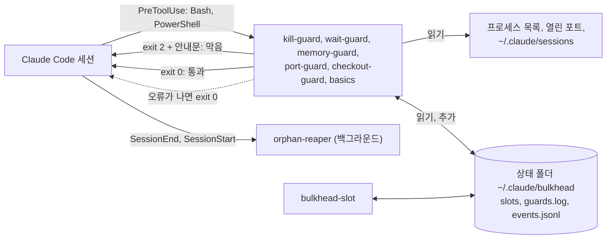

<p align="center">
  <a href="README.md">English</a> |
  <strong>한국어</strong> |
  <a href="README.zh-CN.md">简体中文</a>
</p>

<p align="center">
  
</p>

<h1 align="center">claude-bulkhead</h1>

<p align="center">
  <strong>한 컴퓨터에서 Claude Code 세션 여러 개를 돌릴 때, 서로의 서버를 죽이거나 램을 바닥내지 못하게 막는 훅 모음입니다.</strong>
</p>

<p align="center">가드 7개, 명령 9개, 상태 줄, 슬래시 명령 5개, 스킬 1개, 의존성 0개</p>

<p align="center">
  <a href="https://github.com/Myeongseok-Kang/claude-bulkhead/actions/workflows/test.yml"></a>
  
  
  <a href="LICENSE"></a>
</p>

<p align="center">
  <a href="#무엇인가"><strong>무엇인가</strong></a> |
  <a href="#왜-필요한가"><strong>왜</strong></a> |
  <a href="#하는-일"><strong>기능</strong></a> |
  <a href="#설치"><strong>설치</strong></a> |
  <a href="#빠른-시작"><strong>빠른 시작</strong></a> |
  <a href="#다른-컴퓨터에서-무거운-일-돌리기-선택"><strong>원격</strong></a> |
  <a href="#동작-방식"><strong>동작 방식</strong></a> |
  <a href="#가드"><strong>가드</strong></a> |
  <a href="#자주-묻는-질문"><strong>FAQ</strong></a>
</p>

> 릴리스 노트: [CHANGELOG.md](CHANGELOG.md)

## 무엇인가

Claude Code 훅은 Claude Code 가 정해진 순간(예를 들어 셸 명령을 실행하기 직전)마다 돌리는 작은 프로그램입니다. 훅은 그 명령을 멈추고 Claude 에게 이유를 알려 줄 수 있습니다.

bulkhead 는 한 가지 상황을 위한 훅 모음입니다. Claude Code 세션 여러 개와 그 서브에이전트가 한 컴퓨터에서 동시에 일하는 상황입니다. 세션은 저마다 컴퓨터를 혼자 쓴다고 여깁니다. bulkhead 는 셸 명령마다 다른 세션이 하는 일과 맞춰 봅니다. 어떤 프로세스와 포트가 어느 세션 것인지, 램이 얼마나 남았는지, 각 세션이 어느 git 트리에서 일하는지를 봅니다. 다른 세션을 다치게 할 명령이면 막고, 대신 실행할 안전한 명령을 Claude 에게 알려 줍니다.

**이런 경우에 필요합니다.** Claude Code 세션을 동시에 두 개 이상 돌리는 경우입니다. 보통 git worktree 마다 하나씩 띄웁니다. 세션이나 서브에이전트가 개발 서버, 빌드, 테스트를 띄우는 경우도 해당합니다.

**이런 경우엔 아마 필요 없습니다.** 세션을 한 번에 하나만 쓰고, 서버나 빌드를 띄우게 하지 않는 경우입니다. bulkhead 가 하는 일 대부분은 세션끼리 부딪히는 문제입니다.

| bulkhead 없이 | bulkhead 와 함께 |
|---|---|
| 에이전트가 `pkill node` 로 자기 개발 서버를 재시작하고, 다른 worktree 의 서버가 같이 죽습니다. | kill-guard 가 막고, 자기 PID 를 찾아 그것만 끄는 방법을 알려 줍니다. |
| worktree 두 개가 `npm run dev` 를 칩니다. 두 번째는 3001 로 옮겨 가는데 에이전트는 계속 `localhost:3000` 을 보고 다른 브랜치 화면을 확인합니다. | port-guard 가 두 번째 실행을 막고 빈 포트를 알려 줍니다. `bulkhead port` 로도 빈 포트를 얻습니다. |
| 세 세션이 같은 1분 안에 `next build`, `npm test`, Playwright 를 시작하고 컴퓨터가 멈춥니다. | memory-guard 가 램이 모자랄 때 무거운 명령을 막습니다. `bulkhead-slot` 을 거치면 세 번째 작업은 자리가 날 때까지 대기열에서 기다립니다. |
| 다른 세션이 고치고 있는 트리에서 한 세션이 다른 브랜치로 checkout 합니다. | checkout-guard 가 막고 `git worktree add` 를 권합니다. |
| 세션이 끝났는데 그 세션의 개발 서버, 테스트 워커, 감시 프로세스가 램과 포트를 잡은 채 계속 돕니다. | 세션이 끝나고 몇 초 안에 orphan-reaper 가 끕니다. |
| 서브에이전트가 포그라운드에서 10분 동안 기다립니다. 그동안 세션은 대답을 못 하고 프롬프트 캐시도 만료됩니다. | wait-guard 가 막고 `run_in_background: true` 로 돌리라고 알려 줍니다. |

## 왜 필요한가

Claude Code 로 일을 빨리 끝내는 흔한 방법은 한 저장소에 세션을 여러 개 띄우는 것입니다. 세션마다 git worktree 를 하나씩 주고, 세션마다 서브에이전트가 따로 돕니다. 브랜치는 git 이 나눠 줍니다. 하지만 컴퓨터는 나눠 주지 않습니다. 모든 세션이 같은 포트, 같은 프로세스 목록, 같은 램을 씁니다. 여기서 부딪힙니다.

- 같은 앱의 worktree 두 개가 둘 다 `npm run dev` 를 칩니다. 두 번째는 3000 번 포트에서 실패하거나, 조용히 3001 로 옮겨 갑니다. 그런데 에이전트는 계속 `localhost:3000` 을 열어 보고 다른 브랜치 화면을 봅니다.
- 에이전트가 자기 서버를 재시작하려고 `pkill node` 나 `taskkill /IM node.exe` 를 칩니다. 다른 worktree 의 개발 서버와 테스트가 다 죽고, 때로는 자기 세션도 죽습니다.
- 세 세션이 같은 1분 안에 `npm test`, `next build`, Playwright 를 시작하고 컴퓨터가 멈춥니다.
- 세션이 끝나도 그 세션이 띄운 개발 서버는 계속 돕니다.

Claude Code 이슈 트래커에 바로 이런 보고가 많습니다.

- [#13941](https://github.com/anthropics/claude-code/issues/13941): 개발 서버를 재시작하라고 했더니 `taskkill //IM node.exe` 나 `pkill node` 를 쳐서 자기 세션까지 죽였습니다.
- [#34754](https://github.com/anthropics/claude-code/issues/34754): 사용자가 건드리지 말라고 PID 를 적어 뒀는데도 `taskkill //F //IM python.exe` 로 오래 돌던 시뮬레이션 두 개를 죽였습니다.
- [#43225](https://github.com/anthropics/claude-code/issues/43225): 봇 하나를 재시작하라고 했더니 컴퓨터의 Python 프로세스를 전부, 서비스 약 20개를 강제 종료했습니다.
- [#53229](https://github.com/anthropics/claude-code/issues/53229): 안 쓰는 개발 서버만 끄라고 했는데 정체를 확인하지 않은 게이트웨이와 Postgres 프로세스까지 껐습니다.
- [#15487](https://github.com/anthropics/claude-code/issues/15487): 서브에이전트 프로세스 24개가 4 GB VPS 를 가득 채워 재부팅해야 했습니다. 댓글에는 24 GB Mac 이 같은 식으로 멈췄다는 보고도 있습니다.
- [#11502](https://github.com/anthropics/claude-code/issues/11502), [#25180](https://github.com/anthropics/claude-code/issues/25180): 에이전트가 띄운 프로세스가 에이전트보다 오래 남습니다. 한 보고는 Node 프로세스 60개, 다른 보고는 pytest 워커 550개였습니다.

claude-bulkhead 는 이런 일을 하나씩 막거나 치우는 작은 훅 모음입니다. 훅마다 따로 끌 수 있습니다. 이름은 bulkhead(격벽) 패턴에서 왔습니다. 배의 한 칸에 물이 차도 배 전체가 가라앉으면 안 된다는 뜻입니다.

## 하는 일

| | |
|---|---|
| **[kill-guard](docs/guards/kill-guard.md)**<br>`pkill node`, `taskkill /IM`, `Stop-Process -Name` 처럼 프로그램 이름으로 끄는 명령을 막습니다. PID 로 끄는 건 통과합니다. | **[port-guard](docs/guards/port-guard.md)**<br>다른 세션이 쓰는 포트에 개발 서버를 띄우거나, 그 포트로 남의 서버를 끄는 명령을 막습니다. |
| **[memory-guard, bulkhead-slot](docs/guards/memory-guard.md)**<br>램이 모자랄 때 무거운 명령을 막고, 모든 세션이 같이 쓰는 램 예산에 무거운 작업을 줄 세웁니다. | **[checkout-guard](docs/guards/checkout-guard.md)**<br>다른 세션이 같은 작업 트리에 있을 때 `git checkout`, `stash`, `reset --hard` 등을 막습니다. |
| **[wait-guard](docs/guards/wait-guard.md)**<br>3분이 넘는 포그라운드 sleep 반복을 막습니다. 다음 요청이 프롬프트 캐시 전체를 다시 쓰게 되기 때문입니다. | **[orphan-reaper](docs/guards/orphan-reaper.md)**<br>세션이 끝나면, 그 세션이 남긴 개발 서버, 테스트 워커, 감시 프로세스, 헤드리스 브라우저를 끕니다. |
| **[basics](docs/guards/basics.md)**<br>루트나 홈을 향한 `rm -rf`, `main` 강제 푸시, 커밋 안 한 변경을 날리는 리셋을 막습니다. | **[`bulkhead status`, `top`, `log`, `doctor`](#지금-도는-것-보기)**<br>세션마다 램, 포트, 대기 중인 작업, 가드가 막은 기록을 보여 줍니다. |
| **[상태 줄](#상태-줄)**<br>Claude Code 상태 줄에 `3 sessions  2 heavy  9.1 GB free` 를 띄웁니다. 100 ms 안에 끝납니다. | **[설정과 슬래시 명령](#설정)**<br>컴퓨터 단위, 프로젝트 단위 설정 파일과 허용 목록. `/bulkhead:status`, `/bulkhead:log`, `/bulkhead:doctor`, `/bulkhead:reap`. |

선택 기능: **[`bulkhead remote`](#다른-컴퓨터에서-무거운-일-돌리기-선택)** 는 이 컴퓨터의 램이 모자랄 때 시험 묶음, 빌드, 브라우저 실행을 SSH 로 다른 컴퓨터에서 돌립니다.

## 데모


[docs/demo.sh](docs/demo.sh) 로 녹화했습니다. 두 세션은 이름만 `claude` 인 대역 프로세스입니다. 화면에 찍힌 글은 전부 실제 훅 스크립트와 `bulkhead status` 가 낸 것입니다.

## 설치

```
/plugin marketplace add Myeongseok-Kang/claude-bulkhead
/plugin install bulkhead@bulkhead
```

`PATH` 에 Node 18 이상이 있어야 합니다. Claude Code 네이티브 설치 프로그램은 Node 를 깔지 않으니 먼저 `node --version` 으로 확인하세요. Node 가 없으면 훅이 하나도 뜨지 않습니다. 아무것도 막지 못하고, 도구를 부를 때마다 훅마다 `hook error` 알림이 뜹니다. 다른 의존성은 없습니다.

## 빠른 시작

1. 위처럼 플러그인을 설치하고 Claude Code 세션을 새로 엽니다.
2. 설정을 점검합니다. Claude Code 안에서 `/bulkhead:doctor` 를 치거나, Bash 도구로 `bulkhead doctor` 를 실행합니다. 모든 줄이 `OK` 여야 합니다. `WARN` 이나 `FAIL` 줄에는 가드 이름과 이유가 나옵니다.
3. 세션 옆에 터미널을 하나 열고 `bulkhead top` 을 실행합니다. 세션, 램, 포트, 무거운 작업이 실시간으로 보입니다. `q` 로 나갑니다.

그다음은 할 일이 없습니다. Bash 와 PowerShell 호출마다 가드가 돕니다. 무엇을 막았는지는 `bulkhead log` 나 `/bulkhead:log` 로 봅니다. `bulkhead log --summary` 는 내 컴퓨터에서 가드별로 몇 번 막았는지 셉니다. 기준값을 바꾸거나 특정 명령을 허용하려면 [docs/configuration.md](docs/configuration.md) 를 보세요. 명령 전체 목록은 [docs/commands.md](docs/commands.md) 에 있습니다.

## 다른 컴퓨터에서 무거운 일 돌리기 (선택)

여러 세션이 한꺼번에 시험 묶음과 빌드를 돌리면 컴퓨터 한 대의 램이 모자랍니다. memory-guard 가 명령을 막거나 bulkhead-slot 이 줄을 세웁니다. 거의 놀고 있는 컴퓨터가 한 대 더 있다면 `bulkhead remote` 로 무거운 명령을 그쪽에서 돌릴 수 있습니다.

<p align="center">
  
</p>

```
bulkhead remote add buildbox dev@192.168.1.20 --ssh-option=IdentityFile=~/.ssh/buildbox
bulkhead remote run -- npm test
```

```
[bulkhead remote] buildbox: 3f2a1c9 already there, 3 changed files (24 KB), 1 deleted
[bulkhead remote] buildbox  copy a  /home/dev/bulkhead-remote/acme-web-3f9a1c  port 7172
...시험 출력...
[bulkhead remote] exit 0 after 1m 12s (copy a)
```

- **보내는 것.** 지금 커밋을 git 번들로 보냅니다. 원격에 아직 없는 커밋만 갑니다. 커밋하지 않은 변경도 지운 파일까지 함께 갑니다. 무시된 파일은 `--files` 로 이름을 댈 때만 갑니다. 저장소 밖의 파일은 보내지 않습니다.
- **도는 곳.** 원격에 있는 저장소 사본(최대 8개) 가운데 하나에서 돕니다. 그래서 동시에 돌아도 작업 트리를 나눠 쓰지 않습니다. `node_modules` 는 실행 사이에 남아 있습니다. 실행마다 `$BULKHEAD_PORT` 에 자기 포트를 받습니다.
- **자리.** 원격의 잠금이 사본 하나와 작업 칸 하나를 잡습니다. `--gb=N` 을 주면 원격에 N GB 가 빌 때까지 기다립니다. `--wait` 분 안에 자리가 안 나면 exit 3 으로 끝납니다.
- **정리.** 명령이 끝나거나 SSH 연결이 끊기면(Ctrl-C, 도구 시간 초과) 원격에서 그 명령이 띄운 것을 모두 끕니다. 그 포트에 남은 서버도 끕니다.
- **원격 컴퓨터** 에는 SSH 서버, `bash`, `git`, `tar` 만 있으면 됩니다. Linux, macOS, Git for Windows 를 깐 Windows 모두 됩니다.

`bulkhead remote fetch PATH` 는 마지막 실행이 쓴 사본에서 파일을 가져옵니다. `bulkhead remote status` 는 원격마다 남은 램과 도는 작업을 보여 줍니다. Claude Code 안에서는 `/bulkhead:remote <명령>` 이 그 명령을 원격에서 백그라운드로 돌립니다. 설정, 옵션, exit 코드는 [docs/remote.md](docs/remote.md) 에 있습니다(영어).

## 동작 방식



가드는 각각 의존성 없는 Node 스크립트입니다. Claude Code 가 도구 호출을 JSON 으로 넘겨 줍니다. 가드는 명령 글을 먼저 보고, 맞는 모양일 때만 더 들여다봅니다. 프로세스 목록, 열린 포트, Claude Code 가 `~/.claude/sessions` 에 남기는 세션 파일, 남은 램, `git status` 같은 것들입니다. 막을 때는 exit 2 와 함께 대신 무엇을 하면 되는지 Claude 에게 알려 줍니다. 가드 안에서 오류가 나면 호출을 그냥 통과시킵니다. 가드가 고장 나도 작업이 멈추지는 않습니다.

컴퓨터의 모든 세션이 상태 폴더 하나를 같이 씁니다. bulkhead-slot 의 램 예약과 막은 기록이 여기에 남습니다. 상태 폴더 구조와 OS 별로 세션을 찾는 방법은 [docs/architecture.md](docs/architecture.md) 에 있습니다.

## 가드

가드마다 막는 명령, 통과하는 명령, Claude 가 보는 안내문, 한계를 적은 문서가 있습니다(영어). 짧게 정리하면 이렇습니다.

<details>
<summary><strong>kill-guard</strong>: 이름으로 끄기</summary>

`taskkill /IM`, PID 없는 `taskkill /FI`, `Stop-Process -Name`, `Get-Process node | Stop-Process`, `pkill`, `killall`, `kill $(pgrep node)`, `wmic ... delete` 처럼 여러 세션이 같이 쓰는 프로그램(`node`, `python`, `java`, `chrome`, `git`, `vite` 등)을 이름으로 끄는 명령을 막습니다. PID 와 프로젝트 경로로 끄는 건 통과합니다. 포트로 끄는 것도 통과하지만, 다른 세션의 포트면 port-guard 가 막습니다. 막을 때 자기 PID 를 찾는 방법을 알려 줍니다.

끄기: `BULKHEAD_DISABLE=kill-guard`. 자세히: [docs/guards/kill-guard.md](docs/guards/kill-guard.md)
</details>

<details>
<summary><strong>port-guard</strong>: 다른 세션의 포트</summary>

다른 Claude 세션이 이미 듣고 있는 포트에 개발 서버(`npm run dev`, `next dev`, `vite`, `uvicorn`, `rails s` 등)를 띄우려 하면 막고 빈 포트를 알려 줍니다. 다른 세션의 포트를 `npx kill-port 3000`, `fuser -k 3000/tcp`, `lsof -ti :3000 | xargs kill` 처럼 포트로 끄는 명령도 막습니다.

끄기: `BULKHEAD_DISABLE=port-guard`. 자세히: [docs/guards/port-guard.md](docs/guards/port-guard.md)
</details>

<details>
<summary><strong>memory-guard, bulkhead-slot</strong>: 램</summary>

남은 램이 3 GB 미만이면(램 20 GB 미만 컴퓨터는 전체의 15% 미만이면) 무거운 명령(테스트 러너, `next build`, `tsc`, Gradle, 안드로이드 에뮬레이터, Playwright, `cargo test`, `docker build` 등)을 막습니다. `bulkhead-slot run --gb=4 -- <명령>` 은 같이 쓰는 램 예산에 자리가 날 때까지 기다렸다가 명령을 돌리고, 끝나면 자리를 돌려줍니다.

끄기: `BULKHEAD_DISABLE=memory-guard`. 자세히: [docs/guards/memory-guard.md](docs/guards/memory-guard.md)
</details>

<details>
<summary><strong>checkout-guard</strong>: 한 git 트리에 세션 두 개</summary>

다른 세션이 살아 있고 같은 작업 트리에 있을 때 `git checkout <브랜치>`, `switch`, `stash`, `reset --hard`, `clean -f`, `rebase`, `merge`, `restore .`, 변경이 남은 상태의 `pull` 을 막고 `git worktree add` 를 권합니다.

끄기: `BULKHEAD_DISABLE=checkout-guard`. 자세히: [docs/guards/checkout-guard.md](docs/guards/checkout-guard.md)
</details>

<details>
<summary><strong>wait-guard</strong>: 긴 포그라운드 대기</summary>

sleep 을 합쳐 180초가 넘을 수 있는 포그라운드 명령을 막습니다. 요청이 5분쯤 없으면 프롬프트 캐시가 만료됩니다. 그래서 서브에이전트가 포그라운드에서 기다리다 깨어날 때마다 문맥 전체를 캐시에 다시 씁니다. 막을 때 `run_in_background: true` 로 돌리라고 알려 줍니다. 백그라운드 작업 안의 sleep(`sleep 600 &`)은 통과합니다. 도구 시간 제한이 기본값 120초면 대기가 한도를 넘을 수 없어서, 호출이 시간 제한을 늘렸을 때만 막습니다.

끄기: `BULKHEAD_DISABLE=wait-guard`. 한도는 `BULKHEAD_WAIT_MAX_SEC` 로 바꿉니다. 자세히: [docs/guards/wait-guard.md](docs/guards/wait-guard.md)
</details>

<details>
<summary><strong>orphan-reaper</strong>: 끝난 세션이 남긴 프로세스</summary>

세션이 끝나면 숨은 백그라운드 대기 프로세스가, 그 세션이 도구 셸에서 띄우고 남겨 둔 것을 끕니다. 포트를 듣는 개발 서버와 그 밖의 프로세스, 테스트 러너와 워커(Vitest, Jest, Playwright, pytest 와 xdist, `cargo test`, `go test` 등), `tsc --watch` 나 nodemon 같은 감시 프로세스, `next build` 같은 빌드, 헤드리스 브라우저가 대상입니다. 세션이 비정상으로 끝나 남은 것은 다음 세션이 시작될 때 한 번 더 훑어 끕니다. 에디터, 터미널, Gradle 이나 adb 같은 공용 데몬, 사용자가 직접 띄운 것은 건드리지 않습니다. `bulkhead reap --dry-run` 으로 무엇을 왜 끌지 미리 볼 수 있습니다. Windows, Linux, macOS 를 지원합니다(macOS 는 픽스처로만 시험).

끄기: `BULKHEAD_DISABLE=orphan-reaper`. 자세히: [docs/guards/orphan-reaper.md](docs/guards/orphan-reaper.md)
</details>

<details>
<summary><strong>basics</strong>: 되돌릴 수 없는 실수 세 가지</summary>

`rm-root`(루트, 홈, 저장소 위 폴더를 향한 `rm -rf`), `force-push-main`(`main` 이나 `master` 로 `git push --force`. `--force-with-lease` 는 통과), `discard-changes`(커밋 안 한 작업을 날리는 `git reset --hard`, `git clean -fd`).

끄기: `BULKHEAD_DISABLE=basics`, 또는 규칙 이름으로 하나씩. 자세히: [docs/guards/basics.md](docs/guards/basics.md)
</details>

## 다른 훅 모음과의 관계

일반 안전 훅 모음은 세션 하나를 위험한 명령에서 지킵니다. 예를 들어 [claude-forge](https://github.com/sangrokjung/claude-forge) 에는 출력에 섞인 비밀 값을 걸러 내고, 파이프로 받는 원격 스크립트와 파괴적인 SQL 을 막는 훅이 있습니다. [dcg](https://github.com/Dicklesworthstone/destructive_command_guard) 와 [cc-safety-net](https://github.com/kenryu42/claude-code-safety-net) 은 파괴적인 셸 명령과 git 명령을 폭넓게 다룹니다. 같이 쓸 만한 도구들입니다.

bulkhead 는 다른 문제를 다룹니다. 한 컴퓨터의 세션들이 프로세스 소유, 포트, 같이 쓰는 램, 같이 쓰는 git 트리 때문에 서로 부딪히는 문제입니다. 위 도구들과 겹치는 건 `basics` 규칙 세 개뿐이고, 다른 도구가 이미 다룬다면 `BULKHEAD_DISABLE=basics` 로 끄면 됩니다. bulkhead 는 다른 훅과 함께 돕니다. Claude Code 는 도구 호출에 맞는 훅을 모두 돌리고, 그중 하나라도 막으면 그 호출은 멈춥니다.

## 설정

기본값 그대로 쓰면 따로 정할 것이 없습니다. 바꾸려면 설정 파일을 씁니다. 컴퓨터 단위는 `~/.claude/bulkhead/config.json`, 프로젝트 단위는 `<repo>/.claude/bulkhead.json` 입니다(`.git` 이 있는 폴더까지 위로 올라가며 찾습니다). 프로젝트 설정이 전역 설정보다 우선합니다. 예를 들어 일부러 `ffmpeg` 를 쓰고 통합 테스트가 오래 걸리는 프로젝트라면 이렇게 둡니다.

```json
{
  "killGuard": { "allowNames": ["ffmpeg"] },
  "waitGuard": { "limitSeconds": 300 },
  "portGuard": { "ignorePorts": [9229] },
  "basics": { "protectedBranches": ["main", "release"] }
}
```

가드는 모두 `"<가드>": { "enabled": false }` 로 끌 수 있습니다. `bulkhead config` 는 설정마다 실제 값과 그 값이 어디서 왔는지 보여 줍니다. 파일이 깨져 있으면 그 파일은 무시하고 기본값으로 돌며, 세션을 시작할 때 알림을 한 번 띄웁니다. 키 전체는 [docs/configuration.md](docs/configuration.md) 에 있고, [config.example.json](config.example.json) 에 모든 키가 들어 있습니다.

환경 변수도 그대로 되고, 두 파일보다 우선합니다. `~/.claude/settings.json` 의 `env` 칸에 넣는 게 가장 쉽습니다.

<details>
<summary>환경 변수 전체</summary>

| 변수 | 기본값 | 같은 설정 |
|---|---|---|
| `BULKHEAD_DISABLE` | 비어 있음 | 끌 가드를 쉼표로 나열: `kill-guard`, `wait-guard`, `memory-guard`, `port-guard`, `checkout-guard`, `orphan-reaper`, `basics`, `all`. basics 규칙은 `rm-root`, `force-push-main`, `discard-changes` 로 하나씩 끌 수도 있습니다. 여기 적은 가드는 파일 설정과 상관없이 꺼집니다 |
| `BULKHEAD_WAIT_MAX_SEC` | 180 | `waitGuard.limitSeconds` |
| `BULKHEAD_MIN_FREE_GB` | 3, 또는 램의 15% 중 작은 값 | `memory.minFreeGb` |
| `BULKHEAD_SLOT_FLOOR_GB` | 5, 또는 램의 25% 중 작은 값 | `memory.slotFloorGb` |
| `BULKHEAD_MAX_COMMIT_PCT` | 75 | `memory.maxCommitPct`(Windows 만) |
| `BULKHEAD_NO_LOG` | 비어 있음 | `1` 이면 `log.enabled: false` |
| `BULKHEAD_STATE_DIR` | `~/.claude/bulkhead` | 슬롯, 이벤트 기록, `guards.log`, 전역 설정 파일이 있는 곳 |
| `BULKHEAD_SSH` | `PATH` 의 `ssh` | `bulkhead remote` 가 쓰는 ssh 클라이언트 |

</details>

## 지금 도는 것 보기

`bulkhead` 는 `bulkhead-slot` 과 함께 Bash 도구의 `PATH` 에 들어갑니다. Claude Code 안에서는 `/bulkhead:status`, `/bulkhead:log [24h|7d]`, `/bulkhead:doctor`, `/bulkhead:reap` 이 해당 명령을 돌리고 결과를 정리해 줍니다. 내 터미널에서 쓰려면 경로로 부릅니다. 예: `node ~/.claude/plugins/cache/bulkhead/bulkhead/0.1.1/bin/bulkhead top`. 캐시 경로는 설치마다 다르니 `/plugin` 에서 확인하세요. 표를 내는 명령은 모두 `--json` 을 받습니다. 전체 설명은 [docs/commands.md](docs/commands.md) 에 있습니다.

### bulkhead status

컴퓨터의 모든 Claude Code 세션과 각 프로세스 트리의 메모리, 듣고 있는 포트, bulkhead-slot 이 잡은 작업과 기다리는 작업, 남은 램을 보여 줍니다.

```
$ bulkhead status
SESSION  STARTED       RSS     PROJECT
18672    Oct 12 17:49  1.4 GB  ~/src/acme-web
  :3000  node.exe  pid 24632
21888    Oct 12 17:52  353 MB  ~/src/acme-web-auth
26448    03:43         625 MB  ~/src/acme-web-checkout
  :3001  node.exe  pid 31020

SLOT    GB  PID    AGE    COMMAND
slot-1  4   30112  6 min  npx playwright test

WAITING  GB  PID    FOR    COMMAND
#1       3   30200  2 min  npm run build

9.9 GB free of 31.8 GB, commit 68%
```

`bulkhead slot ...` 은 `bulkhead-slot ...` 과 같습니다.

### bulkhead top

같은 내용을 전체 화면으로 실시간으로 보여 줍니다. Linux 와 macOS 는 2초마다, Windows 는 4초마다 새로 그립니다. Windows 에서는 프로세스를 한 번 훑는 데 1, 2초가 걸리기 때문입니다. 훑기는 워커 스레드에서 돌아서 키 입력이 기다리지 않습니다. `q`, `Esc`, `Ctrl-C` 로 나가고 `r` 로 바로 새로 고칩니다.

```
bulkhead top  14:30:05                                         scan 1.4s  every 4s  q quit  r refresh
RAM ████████████████░░░░░░░░░░░░░░  9.9 GB free of 31.8 GB  commit 68%

SESSIONS 3
PID      STARTED       PROJECT                         RSS              PROCS  PORTS
18672    Oct 12 17:49  ~/src/acme-web               1.4 GB  ██████████     12  :3000 :24678
21888    Oct 12 17:52  ~/src/acme-web-auth          353 MB  ███░░░░░░░      3  -
26448    03:43         ~/src/acme-web-checkout      625 MB  ████░░░░░░      5  :3001

HEAVY JOBS  1 running, 1 waiting
slot-1  4 GB   30112   6 min   npx playwright test
wait #1 3 GB   30200   2 min   npm run build  (this machine has 16 GB; one heavy job at a time)

RECENT BLOCKS
14:29  kill-guard     taskkill-im    ~/src/acme-web-auth      taskkill /F /IM node.exe
14:12  wait-guard     poll-loop      ~/src/acme-web-checkout  until [ -f out/DONE ]; do sleep 30; done
```

터미널이 좁으면 줄을 넘기지 않고 칸을 뺍니다. 출력이 터미널이 아니거나 `--once` 를 주면 화면 하나만 찍고 끝납니다.

### bulkhead log

가드가 막을 때마다, orphan-reaper 가 프로세스를 끌 때마다 `<상태 폴더>/events.jsonl` 에 JSON 한 줄을 씁니다. 시각, 가드, 규칙, 세션, 프로젝트, 200자로 자른 명령이 들어갑니다. 이 파일은 내 컴퓨터에만 있고, 1 MB 에서 교체되며 이전 파일 하나를 남깁니다. `BULKHEAD_NO_LOG=1` 로 끕니다.

```
$ bulkhead log --summary --since 7d
10 blocks in the last 7 days, 3 projects, 4 sessions

GUARD         RULE             COUNT  LAST
wait-guard    poll-loop            3  06:40  ████████████████████████
wait-guard    long-sleep           2  06:40  ████████████████
basics        force-push-main      1  06:40  ████████
basics        rm-root              1  06:40  ████████
kill-guard    pkill                1  06:40  ████████
kill-guard    taskkill-im          1  06:40  ████████
memory-guard  slot-files           1  06:40  ████████

PROJECT                  COUNT
~/src/acme-web               4
~/src/acme-web-auth          3
~/src/acme-web-checkout      3
```

`bulkhead log -n 20` 은 기록 자체를 나열합니다. `--since 30m|24h|7d|2w|<날짜>` 로 기간을, `--guard kill-guard` 로 가드를 고릅니다.

### bulkhead doctor

Node, 플러그인 파일, 상태 폴더, 설정 파일, 가드마다 켜졌는지와 그 이유, 실제 훅 실행, 프로세스 읽기와 걸린 시간, 세션 파일, 이 컴퓨터에 맞춰 계산한 램 기준, 잡힌 슬롯, 이벤트 기록, git 을 점검합니다. 하나라도 실패하면 종료 코드가 1 입니다.

```
$ bulkhead doctor
OK    node            v24.11.0
OK    plugin          ~/.claude/plugins/cache/bulkhead/bulkhead/0.1.1, hooks: 2 SessionStart, 1 SessionEnd, 6 PreToolUse
OK    state dir       ~/.claude/bulkhead is writable
OK    config          no config files, defaults in use
OK    kill-guard      on
OK    wait-guard      on, limit 180s
OK    memory-guard    on
OK    port-guard      on
OK    checkout-guard  on
OK    basics          on, protected branches: main, master
OK    orphan-reaper   on, at session start and after each session ends
OK    hook run        kill-guard blocked a test command in 90 ms
OK    processes       356 processes, 21 listening ports, 8 Claude sessions in 2.4s
OK    sessions        ~/.claude/sessions (8 session files)
OK    memory          12.2 of 31.8 GB free, commit 43%, memory-guard blocks heavy commands below 3 GB, bulkhead-slot keeps 5 GB free for a second job, and waits while commit is above 75%
OK    slots           none held
OK    event log       ~/.claude/bulkhead/events.jsonl, empty so far
OK    git             2.52.0.windows.1

18 OK, 0 WARN, 0 FAIL
```

### bulkhead port

IPv4 와 IPv6 모두에서 아무도 듣지 않는 포트를 찍습니다. 두 번째 worktree 가 짐작 없이 서버를 띄울 수 있습니다.

```
npm run dev -- --port $(bulkhead port --near 3000)
```

### bulkhead reap

orphan-reaper 를 지금 바로 돌립니다. `--dry-run` 은 아무것도 끄지 않고, 끌 대상과 걸린 규칙, 그 세션을 끝난 것으로 본 이유를 보여 줍니다.

```
$ bulkhead reap --dry-run
would stop 30112  test-runner  node ~/src/acme-web/node_modules/vitest/dist/workers/forks.js
  Vitest and its worker pool (tinypool); its session has exited and removed snapshot-bash-1791860359256-ezwkie.sh; 6 processes from 30080
1 tree would be stopped. Run `bulkhead reap` to stop it.
```

### 상태 줄

`bulkhead-statusline` 은 Claude Code 상태 줄에 쓸 한 줄을 냅니다.

```
3 sessions  2 heavy  9.1 GB free
```

sessions 는 `~/.claude/sessions` 에서 살아 있는 세션 수, heavy 는 bulkhead-slot 을 잡은 작업 수, free 는 memory-guard 가 쓰는 남은 램입니다. 프로세스를 훑지 않고, 100 ms 안에 끝나고, 상태 폴더에 5초 동안 캐시합니다.

플러그인은 메인 상태 줄을 정할 수 없습니다(플러그인 설정은 `agent` 와 `subagentStatusLine` 만 지원합니다). `~/.claude/settings.json` 에 직접 넣어 주세요.

```json
{
  "statusLine": {
    "type": "command",
    "command": "node ~/.claude/plugins/cache/bulkhead/bulkhead/0.1.1/bin/bulkhead-statusline",
    "refreshInterval": 10
  }
}
```

경로에 플러그인 버전이 들어 있으니 업데이트하면 고쳐야 합니다. 이미 쓰는 상태 줄 스크립트가 있으면 그 안에서 `bulkhead-statusline` 을 불러 뒤에 붙이면 됩니다.

## 자주 묻는 질문

**Claude Code 가 느려지나요?**
조금 느려집니다. 가드 하나는 짧게 도는 Node 프로세스 하나입니다. Windows 11 데스크톱, Node 24 에서 `node scripts/bench-hooks.js 15` 로 재 보니, 통과하는 명령에 가드 하나가 40에서 49 ms 걸렸습니다(15번 돌린 중앙값). Node 를 띄우는 데만 33 ms 가 듭니다. 막은 기록을 이벤트 로그에 쓰는 시간은 재지 못할 만큼 작습니다. 프로세스 목록 읽기(Windows 에서 1, 2초)처럼 느린 일은 명령이 맞는 모양일 때만 합니다. 이미 응답하는 포트에 개발 서버를 띄울 때, 무언가를 끌 때, 무거운 명령일 때입니다. 상태 줄은 100 ms 안에 끝나고 5초 동안 캐시합니다.

**막지 말아야 할 걸 막았어요.**
`bulkhead log` 로 정확한 명령과 이유를 봅니다. 프로젝트 설정 `<repo>/.claude/bulkhead.json` 에서 통과시킵니다. 프로그램 이름은 `killGuard.allowNames`, 같이 쓰는 포트는 `portGuard.ignorePorts`, 더 긴 대기는 `waitGuard.limitSeconds`, 그 프로젝트에서 가드 전체를 끄려면 `"enabled": false` 입니다. [docs/configuration.md](docs/configuration.md) 를 보세요. 그리고 `bulkhead log` 의 그 줄을 붙여 [오탐 이슈](https://github.com/Myeongseok-Kang/claude-bulkhead/issues/new?template=false-positive.yml)를 남겨 주세요. 패턴을 고쳐 모두에게 반영하겠습니다.

**세션을 하나만 써도 쓸모가 있나요?**
있습니다. kill-guard, wait-guard, memory-guard, basics 는 세션 하나와 그 서브에이전트도 똑같이 지킵니다. port-guard 와 checkout-guard 는 다른 세션이 살아 있을 때만 움직입니다. orphan-reaper 는 끝난 세션이 남긴 것을 치웁니다.

**어떤 OS 를 지원하나요?**
Windows, Linux, macOS 이고 Node 18 이상이 필요합니다. orphan-reaper 의 macOS 지원은 `ps` 출력 픽스처로 시험했고, 실제 Mac 에서는 아직 돌려 보지 않았습니다. Linux 에서는 도구 셸에 `CLAUDE_PID` 를 넣어 주는 Claude Code 버전이 필요합니다. Windows 에서 `bulkhead-slot` 은 Git Bash 가 있으면 Git Bash 로, 없으면 `cmd.exe` 로 명령을 돌립니다.

**어디로 뭔가를 보내나요?**
아니요. 원격 수집도 네트워크 호출도 없습니다. 여는 소켓은 port-guard 가 포트가 응답하는지 보려고 `localhost` 에 붙어 보는 것 하나뿐입니다. 기록은 상태 폴더에만 남습니다. 예외는 `bulkhead remote` 하나입니다. 직접 설정한 컴퓨터에, 직접 실행할 때만 SSH 로 붙습니다.

다른 질문(가드를 우회할 수 있는지, 램 숫자를 어떻게 재는지 등)은 [docs/faq.md](docs/faq.md) 에 있습니다(영어).

## 한계

- 가드는 명령 글을 읽습니다. 글을 명령 단위로 나누고 `bash -c`, `cmd /c`, `powershell -EncodedCommand`, `sudo` 같은 감싸개를 세 겹까지 엽니다. 그래도 스크립트 파일, 셸 함수, 별칭 안에 숨은 kill 이나 sleep 은 보지 못합니다. 흔한 모양을 잡을 뿐, 작정한 우회는 못 막습니다.
- memory-guard 와 bulkhead-slot 은 램만 봅니다. CPU, 디스크, GPU 는 제한하지 않습니다.
- bulkhead-slot 은 불렀을 때만 씁니다. 모든 세션이 줄을 서게 강제하지는 않습니다.
- 가드별 한계는 각 가드 문서에 있습니다.

## 지우기

```
/plugin uninstall bulkhead@bulkhead
/plugin marketplace remove bulkhead
```

그다음 상태 폴더(`~/.claude/bulkhead`, 또는 정해 둔 `BULKHEAD_STATE_DIR`)를 지우고, 상태 줄을 넣었다면 `~/.claude/settings.json` 에서 `statusLine` 항목을 뺍니다.

## bulkhead 를 쓰고 있다면

프로젝트 README 에 이 배지를 붙여 보세요.

```markdown
[](https://github.com/Myeongseok-Kang/claude-bulkhead)
```

이렇게 보입니다: [](https://github.com/Myeongseok-Kang/claude-bulkhead)

## 기여

[CONTRIBUTING.md](CONTRIBUTING.md) 를 보세요. 보안 문제는 [SECURITY.md](SECURITY.md) 로 알려 주세요. 변경 기록은 [CHANGELOG.md](CHANGELOG.md) 에 있습니다.

## 라이선스

[MIT](LICENSE)
