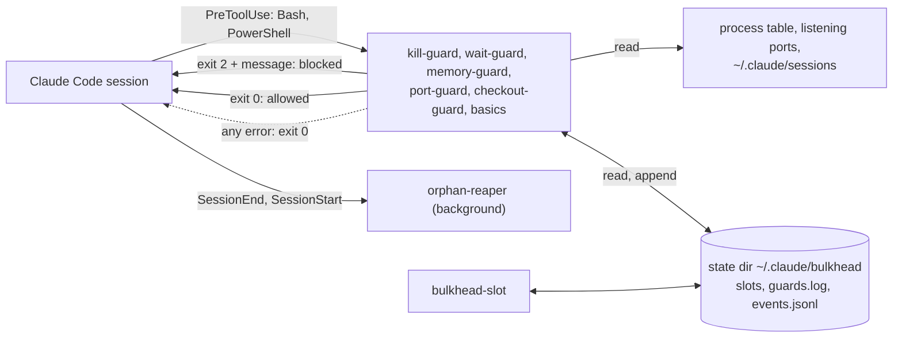

<p align="center">
  <strong>English</strong> |
  <a href="README.ko.md">한국어</a> |
  <a href="README.zh-CN.md">简体中文</a>
</p>

<p align="center">
  
</p>

<h1 align="center">claude-bulkhead</h1>

<p align="center">
  <strong>Hooks that stop parallel Claude Code sessions on one machine from killing each other's servers or running it out of RAM.</strong>
</p>

<p align="center">7 guards, 9 commands, a status line, 5 slash commands, 1 skill, zero dependencies</p>

<p align="center">
  <a href="https://github.com/Myeongseok-Kang/claude-bulkhead/actions/workflows/test.yml"></a>
  
  
  <a href="LICENSE"></a>
</p>

<p align="center">
  <a href="#what-is-it"><strong>What is it</strong></a> |
  <a href="#why-this-exists"><strong>Why</strong></a> |
  <a href="#what-it-does"><strong>Features</strong></a> |
  <a href="#install"><strong>Install</strong></a> |
  <a href="#quick-start"><strong>Quick start</strong></a> |
  <a href="#run-heavy-jobs-on-another-machine-optional"><strong>Remote</strong></a> |
  <a href="#how-it-works"><strong>How it works</strong></a> |
  <a href="#guards"><strong>Guards</strong></a> |
  <a href="#faq"><strong>FAQ</strong></a>
</p>

> Release notes: [CHANGELOG.md](CHANGELOG.md).

## What is it?

Claude Code hooks are small programs that Claude Code runs at fixed points, for example before every shell command, and that can stop the command and tell Claude why.

bulkhead is a set of these hooks for one situation: several Claude Code sessions, and their subagents, working on the same computer at the same time. Each session acts as if it had the machine to itself. bulkhead checks each shell command against what the other sessions are doing: which processes and ports belong to which session, how much RAM is left, and which git tree each session works in. When a command would hurt another session, it is blocked, and Claude gets a message with the safer command to run instead.

**You need it if** you run two or more Claude Code sessions at once, often one per git worktree, or your sessions and subagents start dev servers, builds and test runs.

**You probably do not need it if** you run one session at a time and do not let it start servers or builds. Most of what bulkhead does is about sessions getting in each other's way.

| Without bulkhead | With bulkhead |
|---|---|
| An agent restarts its dev server with `pkill node`, and every other worktree's server dies with it. | kill-guard blocks the command and tells the agent how to find and stop its own PID. |
| Two worktrees run `npm run dev`. The second moves to 3001, but its agent keeps testing `localhost:3000` and sees the other branch. | port-guard blocks the second start and names a free port. `bulkhead port` prints one on demand. |
| Three sessions start `next build`, `npm test` and Playwright in the same minute, and the machine freezes. | memory-guard blocks heavy commands when RAM is low. Through `bulkhead-slot`, the third job waits in a queue until there is room. |
| A session checks out another branch in a tree that a second session is editing. | checkout-guard blocks it and suggests `git worktree add`. |
| A session exits, and its dev servers, test workers and watchers keep running and holding RAM and ports. | orphan-reaper stops them within seconds of the session exiting. |
| A subagent polls in the foreground for ten minutes. The session cannot answer you, and the prompt cache expires. | wait-guard blocks the loop and asks for `run_in_background: true`. |

## Why this exists

A common way to speed up work with Claude Code is to run several sessions on one repository, each in its own git worktree, each with its own subagents. git keeps the branches apart. The machine does not: every session shares the same ports, the same process table and the same RAM. That is where they collide.

- Two worktrees of the same app both run `npm run dev`. The second one fails on port 3000, or quietly moves to 3001 while its agent keeps testing `localhost:3000` and sees the other branch.
- An agent restarts its own server with `pkill node` or `taskkill /IM node.exe` and takes down the dev servers and test runs of every other worktree, and sometimes its own session.
- Three sessions start `npm test`, `next build` and a Playwright run in the same minute, and the machine stops responding.
- A session ends and the dev servers it started keep running.

The Claude Code tracker has many reports of exactly this:

- [#13941](https://github.com/anthropics/claude-code/issues/13941): asked to restart a dev server, Claude ran `taskkill //IM node.exe` or `pkill node` and killed its own session.
- [#34754](https://github.com/anthropics/claude-code/issues/34754): `taskkill //F //IM python.exe` killed two long-running simulations, after the user had marked their PIDs as off limits.
- [#43225](https://github.com/anthropics/claude-code/issues/43225): asked to restart one bot, Claude force-killed every Python process on the machine, about 20 services.
- [#53229](https://github.com/anthropics/claude-code/issues/53229): told to stop only unused dev servers, an agent also killed a gateway and a Postgres process it had not identified.
- [#15487](https://github.com/anthropics/claude-code/issues/15487): 24 subagent processes saturated a 4 GB VPS until it had to be rebooted; a commenter froze a 24 GB Mac the same way.
- [#11502](https://github.com/anthropics/claude-code/issues/11502) and [#25180](https://github.com/anthropics/claude-code/issues/25180): processes started by agents outlive them, 60 Node processes in one report and 550 pytest workers in the other.

claude-bulkhead is a set of small hooks that block or clean up each of these. Each one can be turned off on its own. The name is from the bulkhead pattern: one compartment taking on water should not sink the ship.

## What it does

| | |
|---|---|
| **[kill-guard](docs/guards/kill-guard.md)**<br>Blocks `pkill node`, `taskkill /IM`, `Stop-Process -Name` and other kills by program name. Kills by PID pass. | **[port-guard](docs/guards/port-guard.md)**<br>Blocks starting a dev server on a port another session already serves, and killing that session's server by port. |
| **[memory-guard and bulkhead-slot](docs/guards/memory-guard.md)**<br>Blocks heavy commands when RAM is low, and queues heavy jobs against one RAM budget shared by every session. | **[checkout-guard](docs/guards/checkout-guard.md)**<br>Blocks `git checkout`, `stash`, `reset --hard` and similar when another live session works in the same tree. |
| **[wait-guard](docs/guards/wait-guard.md)**<br>Blocks foreground sleep loops longer than 3 minutes, which make the next request rewrite the whole prompt cache. | **[orphan-reaper](docs/guards/orphan-reaper.md)**<br>When a session exits, stops the dev servers, test workers, watchers and headless browsers it left running. |
| **[basics](docs/guards/basics.md)**<br>Blocks `rm -rf` at a root or home, force-pushes to `main`, and resets that would lose uncommitted work. | **[`bulkhead status`, `top`, `log`, `doctor`](#see-what-is-running)**<br>Shows every session, its RAM, its ports, queued jobs, and what the guards have blocked. |
| **[Status line](#status-line)**<br>`3 sessions  2 heavy  9.1 GB free` in the Claude Code status line, in under 100 ms. | **[Config and slash commands](#configuration)**<br>Per-machine and per-project config with allow lists, plus `/bulkhead:status`, `/bulkhead:log`, `/bulkhead:doctor` and `/bulkhead:reap`. |

Optional: **[`bulkhead remote`](#run-heavy-jobs-on-another-machine-optional)** runs a test suite, a build or a browser run on another machine over SSH, when this one has no RAM to spare.

## Demo


Recorded with [docs/demo.sh](docs/demo.sh). The two sessions are stand-in processes named `claude`; everything printed comes from the hook scripts and `bulkhead status`.

## Install

```
/plugin marketplace add Myeongseok-Kang/claude-bulkhead
/plugin install bulkhead@bulkhead
```

Node 18 or later must be on `PATH`. The native Claude Code installer does not install Node, so check with `node --version` first. Without Node every hook fails to start: nothing is blocked, and Claude Code shows a `hook error` notice for each hook on every tool call. There are no other dependencies.

## Quick start

1. Install the plugin as above and start a new Claude Code session.
2. Check the setup. Inside Claude Code run `/bulkhead:doctor`, or run `bulkhead doctor` in the Bash tool. Every line should say `OK`. A `WARN` or `FAIL` line names the guard and the reason.
3. Open a terminal next to your sessions and run `bulkhead top` to watch sessions, RAM, ports and heavy jobs live. Press `q` to quit.

After that there is nothing to do. The guards run on every Bash and PowerShell call. To see what they stopped, run `bulkhead log` or `/bulkhead:log`; `bulkhead log --summary` counts blocks per guard on your machine. To change a threshold or allow a command, see [docs/configuration.md](docs/configuration.md). All commands are listed in [docs/commands.md](docs/commands.md).

## Run heavy jobs on another machine (optional)

When several sessions run test suites and builds at once, one machine runs out of RAM: memory-guard blocks the commands, or bulkhead-slot makes them queue. If you have a second machine that is mostly idle, `bulkhead remote` runs the heavy command there instead.

<p align="center">
  
</p>

```
bulkhead remote add buildbox dev@192.168.1.20 --ssh-option=IdentityFile=~/.ssh/buildbox
bulkhead remote run -- npm test
```

```
[bulkhead remote] buildbox: 3f2a1c9 already there, 3 changed files (24 KB), 1 deleted
[bulkhead remote] buildbox  copy a  /home/dev/bulkhead-remote/acme-web-3f9a1c  port 7172
...test output...
[bulkhead remote] exit 0 after 1m 12s (copy a)
```

- **What is sent.** The current commit as a git bundle (only the commits the remote does not have yet) and your uncommitted changes, deletions included. Ignored files stay here unless you name them with `--files`. Nothing outside the repository is sent.
- **Where it runs.** In one of up to 8 copies of the repository on the remote, so parallel runs do not share a working tree. `node_modules` is kept between runs. Each run gets its own port in `$BULKHEAD_PORT`.
- **Room.** Locks on the remote hold a copy and a job slot, and `--gb=N` waits until N GB is free there. When there is no room within `--wait` minutes, it exits 3.
- **Cleanup.** When the command ends, or the SSH connection drops (Ctrl-C, a tool timeout), everything it started on the remote is stopped, including a server left on its port.
- **The remote** needs only an SSH server, `bash`, `git` and `tar`. Linux, macOS and Windows with Git for Windows all work.

`bulkhead remote fetch PATH` brings files back from the copy the last run used, and `bulkhead remote status` shows each remote's free RAM and running jobs. In Claude Code, `/bulkhead:remote <command>` runs a command there in the background. Setup, options and exit codes: [docs/remote.md](docs/remote.md).

## How it works



Each guard is a separate Node script with no dependencies. Claude Code pipes the tool call to it as JSON. The guard reads the command text, and only when the command matches does it look further: at the process table, the listening ports, the session files Claude Code keeps in `~/.claude/sessions`, free RAM, or `git status`. A block is exit code 2 with a message that tells Claude what to do instead. Any error inside a guard lets the call through, so a broken guard never stops your work.

Every session on the machine shares one state directory. bulkhead-slot keeps its RAM reservations there, and every block is recorded there. More detail, including the state directory layout and how sessions are found on each OS, is in [docs/architecture.md](docs/architecture.md).

## Guards

Each guard has a page with the exact commands it blocks, what passes, the message Claude sees, and its limits. The short version:

<details>
<summary><strong>kill-guard</strong>: kills by program name</summary>

Blocks `taskkill /IM`, `taskkill /FI` without a PID, `Stop-Process -Name`, `Get-Process node | Stop-Process`, `pkill`, `killall`, `kill $(pgrep node)`, `wmic ... delete` and similar when they target a program other sessions share, such as `node`, `python`, `java`, `chrome`, `git` or `vite`. Kills by PID and by project path pass. Kills by port pass too, unless another session owns the port; port-guard checks those. Claude is told how to find its own PIDs.

Turn off: `BULKHEAD_DISABLE=kill-guard`. Details: [docs/guards/kill-guard.md](docs/guards/kill-guard.md).
</details>

<details>
<summary><strong>port-guard</strong>: ports owned by another session</summary>

Blocks starting a dev server (`npm run dev`, `next dev`, `vite`, `uvicorn`, `rails s` and more) on a port that another Claude session's process tree is listening on, and suggests a free port. It also blocks kill-by-port commands such as `npx kill-port 3000`, `fuser -k 3000/tcp` and `lsof -ti :3000 | xargs kill` when another session owns that port.

Turn off: `BULKHEAD_DISABLE=port-guard`. Details: [docs/guards/port-guard.md](docs/guards/port-guard.md).
</details>

<details>
<summary><strong>memory-guard and bulkhead-slot</strong>: RAM</summary>

memory-guard blocks heavy commands (test runners, `next build`, `tsc`, Gradle, the Android emulator, Playwright, `cargo test`, `docker build` and similar) when free RAM is under 3 GB, or under 15% of RAM on machines with less than 20 GB. `bulkhead-slot run --gb=4 -- <command>` waits until the shared RAM budget has room, runs the command, and frees the slot when it exits.

Turn off: `BULKHEAD_DISABLE=memory-guard`. Details: [docs/guards/memory-guard.md](docs/guards/memory-guard.md).
</details>

<details>
<summary><strong>checkout-guard</strong>: two sessions in one git tree</summary>

Blocks `git checkout <branch>`, `switch`, `stash`, `reset --hard`, `clean -f`, `rebase`, `merge`, `restore .` and a dirty `pull` when another live session works in the same tree, and suggests `git worktree add`.

Turn off: `BULKHEAD_DISABLE=checkout-guard`. Details: [docs/guards/checkout-guard.md](docs/guards/checkout-guard.md).
</details>

<details>
<summary><strong>wait-guard</strong>: long foreground waits</summary>

Blocks a foreground command whose sleeps can add up to more than 180 seconds. The prompt cache expires after about five minutes without a request, so a subagent polling in the foreground rewrites the whole context every time it wakes. Claude is told to run the loop with `run_in_background: true`. Sleeps in a background job (`sleep 600 &`) pass. With the default 120 second tool timeout a wait cannot pass the default limit, so it blocks only when the call raises the timeout.

Turn off: `BULKHEAD_DISABLE=wait-guard`, or raise the limit with `BULKHEAD_WAIT_MAX_SEC`. Details: [docs/guards/wait-guard.md](docs/guards/wait-guard.md).
</details>

<details>
<summary><strong>orphan-reaper</strong>: processes left by sessions that exited</summary>

When a session exits, a hidden background waiter stops what it started from its tool shells and left running: dev servers and anything else listening on a port, test runners and their workers (Vitest, Jest, Playwright, pytest and xdist, `cargo test`, `go test` and more), watchers such as `tsc --watch` and nodemon, builds such as `next build`, and headless browsers. A pass at session start catches what a crash left behind. Editors, terminals, shared daemons such as Gradle or adb, and anything you started yourself are never touched. `bulkhead reap --dry-run` shows what it would stop and why. Windows, Linux and macOS (macOS tested with fixtures).

Turn off: `BULKHEAD_DISABLE=orphan-reaper`. Details: [docs/guards/orphan-reaper.md](docs/guards/orphan-reaper.md).
</details>

<details>
<summary><strong>basics</strong>: three mistakes that cannot be undone</summary>

`rm-root` (`rm -rf` at a root, home or above the repository), `force-push-main` (`git push --force` to `main` or `master`; `--force-with-lease` passes) and `discard-changes` (`git reset --hard` or `git clean -fd` that would lose uncommitted work).

Turn off: `BULKHEAD_DISABLE=basics`, or one rule by name. Details: [docs/guards/basics.md](docs/guards/basics.md).
</details>

## How bulkhead relates to other hook packs

General safety packs protect a session from dangerous commands. For example, [claude-forge](https://github.com/sangrokjung/claude-forge) includes hooks that filter leaked secrets from output, block piped remote scripts and stop destructive SQL, and [dcg](https://github.com/Dicklesworthstone/destructive_command_guard) and [cc-safety-net](https://github.com/kenryu42/claude-code-safety-net) cover destructive shell and git commands broadly. They are worth using.

bulkhead covers a different problem: sessions on one machine getting in each other's way through process ownership, ports, shared RAM and a shared git tree. Only its three `basics` rules overlap with those packs, and you can turn them off with `BULKHEAD_DISABLE=basics` if another pack already covers them. bulkhead runs alongside other hooks: Claude Code runs every hook that matches a tool call, and the call is stopped if any of them blocks it.

## Configuration

The defaults need no setup. To change them, use a config file: `~/.claude/bulkhead/config.json` for the machine, and `<repo>/.claude/bulkhead.json` for one project (found by walking up to the folder with `.git`). Project settings win over the global file. For example, a project that runs `ffmpeg` on purpose and has a slow integration suite:

```json
{
  "killGuard": { "allowNames": ["ffmpeg"] },
  "waitGuard": { "limitSeconds": 300 },
  "portGuard": { "ignorePorts": [9229] },
  "basics": { "protectedBranches": ["main", "release"] }
}
```

Every guard can be turned off with `"<guard>": { "enabled": false }`. `bulkhead config` prints every setting, its value and where it came from. A broken file is ignored, the guards keep their defaults, and the session shows one notice at startup. All keys are in [docs/configuration.md](docs/configuration.md), and [config.example.json](config.example.json) sets each of them.

Environment variables still work and win over both files. The simplest place for them is the `env` block of `~/.claude/settings.json`.

<details>
<summary>All environment variables</summary>

| Variable | Default | Same as |
|---|---|---|
| `BULKHEAD_DISABLE` | empty | Comma-separated guards to turn off: `kill-guard`, `wait-guard`, `memory-guard`, `port-guard`, `checkout-guard`, `orphan-reaper`, `basics`, or `all`. The basics rules can also be turned off one at a time: `rm-root`, `force-push-main`, `discard-changes`. A name here is off whatever the files say |
| `BULKHEAD_WAIT_MAX_SEC` | 180 | `waitGuard.limitSeconds` |
| `BULKHEAD_MIN_FREE_GB` | 3, or 15% of RAM if less | `memory.minFreeGb` |
| `BULKHEAD_SLOT_FLOOR_GB` | 5, or 25% of RAM if less | `memory.slotFloorGb` |
| `BULKHEAD_MAX_COMMIT_PCT` | 75 | `memory.maxCommitPct` (Windows only) |
| `BULKHEAD_NO_LOG` | empty | `log.enabled: false` when set to `1` |
| `BULKHEAD_STATE_DIR` | `~/.claude/bulkhead` | Where slots, the event log, `guards.log` and the global config file live |
| `BULKHEAD_SSH` | `ssh` on `PATH` | The ssh client `bulkhead remote` runs |

</details>

## See what is running

`bulkhead` is on the Bash tool's `PATH` next to `bulkhead-slot`. Inside Claude Code, `/bulkhead:status`, `/bulkhead:log [24h|7d]`, `/bulkhead:doctor` and `/bulkhead:reap` run the matching command and summarize it. To run it in your own terminal, call it by path, for example `node ~/.claude/plugins/cache/bulkhead/bulkhead/0.1.1/bin/bulkhead top` (the cache path depends on your install; `/plugin` shows it). Every command that prints a table takes `--json`. The full reference is [docs/commands.md](docs/commands.md).

### bulkhead status

Every Claude Code session on the machine, the memory its process tree uses, what it has listening on a port, the jobs held in bulkhead-slot and the ones waiting, and free RAM:

```
$ bulkhead status
SESSION  STARTED       RSS     PROJECT
18672    Oct 12 17:49  1.4 GB  ~/src/acme-web
  :3000  node.exe  pid 24632
21888    Oct 12 17:52  353 MB  ~/src/acme-web-auth
26448    03:43         625 MB  ~/src/acme-web-checkout
  :3001  node.exe  pid 31020

SLOT    GB  PID    AGE    COMMAND
slot-1  4   30112  6 min  npx playwright test

WAITING  GB  PID    FOR    COMMAND
#1       3   30200  2 min  npm run build

9.9 GB free of 31.8 GB, commit 68%
```

`bulkhead slot ...` is the same as `bulkhead-slot ...`.

### bulkhead top

The same view, live and full screen. It refreshes every 2 seconds on Linux and macOS and every 4 seconds on Windows, where one process scan takes 1 to 2 seconds. The scan runs in a worker thread, so keys never wait for it. `q`, `Esc` or `Ctrl-C` quit, `r` refreshes.

```
bulkhead top  14:30:05                                         scan 1.4s  every 4s  q quit  r refresh
RAM ████████████████░░░░░░░░░░░░░░  9.9 GB free of 31.8 GB  commit 68%

SESSIONS 3
PID      STARTED       PROJECT                         RSS              PROCS  PORTS
18672    Oct 12 17:49  ~/src/acme-web               1.4 GB  ██████████     12  :3000 :24678
21888    Oct 12 17:52  ~/src/acme-web-auth          353 MB  ███░░░░░░░      3  -
26448    03:43         ~/src/acme-web-checkout      625 MB  ████░░░░░░      5  :3001

HEAVY JOBS  1 running, 1 waiting
slot-1  4 GB   30112   6 min   npx playwright test
wait #1 3 GB   30200   2 min   npm run build  (this machine has 16 GB; one heavy job at a time)

RECENT BLOCKS
14:29  kill-guard     taskkill-im    ~/src/acme-web-auth      taskkill /F /IM node.exe
14:12  wait-guard     poll-loop      ~/src/acme-web-checkout  until [ -f out/DONE ]; do sleep 30; done
```

On a narrow terminal it drops columns instead of wrapping. When the output is not a terminal, or with `--once`, it prints one snapshot and exits.

### bulkhead log

Every block, and every process orphan-reaper stops, is one JSON line in `<state dir>/events.jsonl` with the time, guard, rule, session, project and the command cut to 200 characters. The file stays on your machine, rotates at 1 MB, and keeps one old file. `BULKHEAD_NO_LOG=1` turns it off.

```
$ bulkhead log --summary --since 7d
10 blocks in the last 7 days, 3 projects, 4 sessions

GUARD         RULE             COUNT  LAST
wait-guard    poll-loop            3  06:40  ████████████████████████
wait-guard    long-sleep           2  06:40  ████████████████
basics        force-push-main      1  06:40  ████████
basics        rm-root              1  06:40  ████████
kill-guard    pkill                1  06:40  ████████
kill-guard    taskkill-im          1  06:40  ████████
memory-guard  slot-files           1  06:40  ████████

PROJECT                  COUNT
~/src/acme-web               4
~/src/acme-web-auth          3
~/src/acme-web-checkout      3
```

`bulkhead log -n 20` lists the events themselves, `--since 30m|24h|7d|2w|<date>` limits the time, and `--guard kill-guard` limits the guard.

### bulkhead doctor

Checks Node, the plugin files, the state directory, the config files, each guard (on or off, and why), a real hook run, the process reader with its timing, the session files, the RAM limits computed for this machine, held slots, the event log and git. The exit code is 1 when any check fails.

```
$ bulkhead doctor
OK    node            v24.11.0
OK    plugin          ~/.claude/plugins/cache/bulkhead/bulkhead/0.1.1, hooks: 2 SessionStart, 1 SessionEnd, 6 PreToolUse
OK    state dir       ~/.claude/bulkhead is writable
OK    config          no config files, defaults in use
OK    kill-guard      on
OK    wait-guard      on, limit 180s
OK    memory-guard    on
OK    port-guard      on
OK    checkout-guard  on
OK    basics          on, protected branches: main, master
OK    orphan-reaper   on, at session start and after each session ends
OK    hook run        kill-guard blocked a test command in 90 ms
OK    processes       356 processes, 21 listening ports, 8 Claude sessions in 2.4s
OK    sessions        ~/.claude/sessions (8 session files)
OK    memory          12.2 of 31.8 GB free, commit 43%, memory-guard blocks heavy commands below 3 GB, bulkhead-slot keeps 5 GB free for a second job, and waits while commit is above 75%
OK    slots           none held
OK    event log       ~/.claude/bulkhead/events.jsonl, empty so far
OK    git             2.52.0.windows.1

18 OK, 0 WARN, 0 FAIL
```

### bulkhead port

Prints a port that nothing listens on, checked on IPv4 and IPv6, so a second worktree can start its server without guessing:

```
npm run dev -- --port $(bulkhead port --near 3000)
```

### bulkhead reap

Runs orphan-reaper now. `--dry-run` lists what it would stop, the rule that matched and why the session counts as exited, without stopping anything:

```
$ bulkhead reap --dry-run
would stop 30112  test-runner  node ~/src/acme-web/node_modules/vitest/dist/workers/forks.js
  Vitest and its worker pool (tinypool); its session has exited and removed snapshot-bash-1791860359256-ezwkie.sh; 6 processes from 30080
1 tree would be stopped. Run `bulkhead reap` to stop it.
```

### Status line

`bulkhead-statusline` prints one line for the Claude Code status line:

```
3 sessions  2 heavy  9.1 GB free
```

Sessions are the live entries in `~/.claude/sessions`, heavy is the number of jobs holding a bulkhead-slot, and free is the same measure memory-guard uses. It does not scan processes, takes under 100 ms, and caches the line for 5 seconds in the state directory.

A plugin cannot set the main status line (plugin settings only support `agent` and `subagentStatusLine`), so add it to `~/.claude/settings.json` yourself:

```json
{
  "statusLine": {
    "type": "command",
    "command": "node ~/.claude/plugins/cache/bulkhead/bulkhead/0.1.1/bin/bulkhead-statusline",
    "refreshInterval": 10
  }
}
```

The path contains the plugin version, so update it after a plugin update. If you already have a status line script, call `bulkhead-statusline` from it and append its output.

## FAQ

**Does it slow Claude Code down?**
A little. Each guard is one short Node process. On a Windows 11 desktop with Node 24, `node scripts/bench-hooks.js 15` measured 40 to 49 ms per guard on an allowed command (median of 15 runs), and 33 ms for starting Node alone. Writing a block to the event log adds no measurable time. The guards only do slow work, such as reading the process list (a second or two on Windows), when the command matches: a dev server start on a port that already answers, a kill, a heavy command. The status line takes under 100 ms and is cached for 5 seconds.

**It blocked something it should not have. What do I do?**
Run `bulkhead log` to see the exact command and reason. Let it through in the project config, `<repo>/.claude/bulkhead.json`: `killGuard.allowNames` for a program name, `portGuard.ignorePorts` for a shared port, `waitGuard.limitSeconds` for a longer wait, or `"enabled": false` for the whole guard in that project. See [docs/configuration.md](docs/configuration.md). Then please open a [false positive issue](https://github.com/Myeongseok-Kang/claude-bulkhead/issues/new?template=false-positive.yml) with the line from `bulkhead log`, so the pattern can be fixed for everyone.

**Is it useful with a single session?**
Yes. kill-guard, wait-guard, memory-guard and basics protect one session and its subagents just as well. port-guard and checkout-guard only act when another session is alive, and orphan-reaper cleans up after sessions that have exited.

**Which systems does it support?**
Windows, Linux and macOS, with Node 18 or later. orphan-reaper on macOS is tested with fixtures of `ps` output but not yet on a real Mac, and on Linux it needs a Claude Code version that sets `CLAUDE_PID` for tool shells. On Windows, `bulkhead-slot` runs commands through Git Bash when it is installed and through `cmd.exe` otherwise.

**Does it send anything anywhere?**
No. There is no telemetry and no network call. The only socket it opens is port-guard's connection attempt to `localhost` to see whether a port answers. Logs stay in the state directory. The one exception is `bulkhead remote`, which connects over SSH to a machine you configured, and only when you run it.

More questions, including how the guards can be bypassed and how the RAM numbers are measured, are in [docs/faq.md](docs/faq.md).

## Limitations

- The guards read command text. They split it into commands and open wrappers such as `bash -c`, `cmd /c`, `powershell -EncodedCommand` and `sudo` up to three levels deep, but a kill or a sleep hidden in a script file, a shell function or an alias is not seen. They catch the common shapes, not a determined workaround.
- memory-guard and bulkhead-slot only see RAM. They do not limit CPU, disk or GPU.
- bulkhead-slot is only used when called. Nothing forces every session to queue through it.
- Each guard page lists its own limits.

## Uninstall

```
/plugin uninstall bulkhead@bulkhead
/plugin marketplace remove bulkhead
```

Then delete the state directory (`~/.claude/bulkhead`, or `BULKHEAD_STATE_DIR` if you set it) and remove the `statusLine` entry from `~/.claude/settings.json` if you added one.

## Using bulkhead? Show it

Add this badge to your project's README:

```markdown
[](https://github.com/Myeongseok-Kang/claude-bulkhead)
```

It renders as [](https://github.com/Myeongseok-Kang/claude-bulkhead)

## Contributing

See [CONTRIBUTING.md](CONTRIBUTING.md). Security reports: [SECURITY.md](SECURITY.md). The changelog is in [CHANGELOG.md](CHANGELOG.md).

## License

[MIT](LICENSE)
