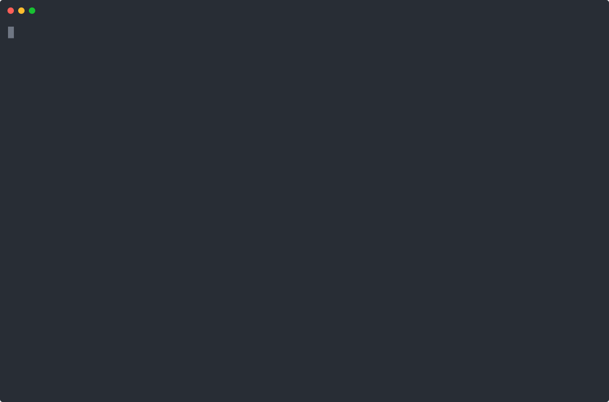
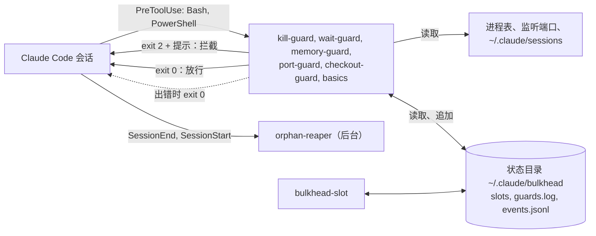

<p align="center">
  <a href="README.md">English</a> |
  <a href="README.ko.md">한국어</a> |
  <strong>简体中文</strong>
</p>

<p align="center">
  
</p>

<h1 align="center">claude-bulkhead</h1>

<p align="center">
  <strong>一组 hook：同一台机器上并行运行多个 Claude Code 会话时，防止它们互相杀掉服务器，或把内存耗尽。</strong>
</p>

<p align="center">7 个 guard，9 个命令，一个状态栏，5 个斜杠命令，1 个 skill，零依赖</p>

<p align="center">
  <a href="https://github.com/Myeongseok-Kang/claude-bulkhead/actions/workflows/test.yml"></a>
  
  
  <a href="LICENSE"></a>
</p>

<p align="center">
  <a href="#这是什么"><strong>这是什么</strong></a> |
  <a href="#为什么需要它"><strong>为什么</strong></a> |
  <a href="#功能"><strong>功能</strong></a> |
  <a href="#安装"><strong>安装</strong></a> |
  <a href="#快速开始"><strong>快速开始</strong></a> |
  <a href="#在另一台机器上运行重任务可选"><strong>远程</strong></a> |
  <a href="#工作原理"><strong>工作原理</strong></a> |
  <a href="#各个-guard"><strong>Guard</strong></a> |
  <a href="#常见问题"><strong>FAQ</strong></a>
</p>

> 发布说明：[CHANGELOG.md](CHANGELOG.md)

## 这是什么

Claude Code 的 hook 是 Claude Code 在固定时机（例如每次执行 shell 命令之前）运行的小程序，它可以拦下这条命令并告诉 Claude 原因。

bulkhead 是针对一种场景的一组 hook：多个 Claude Code 会话及其子代理同时在同一台电脑上工作。每个会话都以为整台机器归它自己。bulkhead 会把每条 shell 命令和其他会话正在做的事对照：哪些进程和端口属于哪个会话、还剩多少内存、每个会话在哪个 git 工作树里。如果一条命令会伤到其他会话，它就会被拦下，Claude 会收到一条提示，告诉它该改用哪条更安全的命令。

**适合你，如果** 你同时运行两个或更多 Claude Code 会话（通常每个 git worktree 一个），或者你的会话和子代理会启动开发服务器、构建和测试。

**大概不需要，如果** 你一次只开一个会话，也不让它启动服务器或构建。bulkhead 处理的主要是会话之间互相干扰的问题。

| 没有 bulkhead | 有 bulkhead |
|---|---|
| 代理用 `pkill node` 重启自己的开发服务器，其他 worktree 的服务器也一起挂掉。 | kill-guard 拦下这条命令，并告诉代理如何找到并只结束自己的 PID。 |
| 两个 worktree 都执行 `npm run dev`。第二个换到了 3001，但它的代理还在测 `localhost:3000`，看到的是另一个分支。 | port-guard 拦下第二次启动并给出空闲端口。`bulkhead port` 也能随时给出一个。 |
| 三个会话在同一分钟里启动 `next build`、`npm test` 和 Playwright，机器卡死。 | 内存不足时 memory-guard 拦截重命令。通过 `bulkhead-slot`，第三个任务会排队，等有空间再运行。 |
| 一个会话在另一个会话正在编辑的工作树里 checkout 了别的分支。 | checkout-guard 拦下它，并建议使用 `git worktree add`。 |
| 会话结束了，它的开发服务器、测试 worker 和监视进程还在跑，占着内存和端口。 | 会话退出后几秒内，orphan-reaper 就会停掉它们。 |
| 子代理在前台轮询了十分钟。这期间会话无法回应你，提示缓存也过期了。 | wait-guard 拦下这个循环，让它改用 `run_in_background: true`。 |

## 为什么需要它

用 Claude Code 提速的常见做法，是在同一个仓库上开多个会话：每个会话一个 git worktree，每个会话再带自己的子代理。分支由 git 隔开，机器却没有隔开。所有会话共用同一组端口、同一张进程表、同一份内存。冲突就出在这里：

- 同一个应用的两个 worktree 都执行 `npm run dev`。第二个要么在 3000 端口上启动失败，要么悄悄换到 3001，而它的代理还在测 `localhost:3000`，看到的是另一个分支。
- 代理想重启自己的服务器，执行了 `pkill node` 或 `taskkill /IM node.exe`，结果其他 worktree 的开发服务器和测试全挂了，有时连自己的会话也一起结束。
- 三个会话在同一分钟里启动 `npm test`、`next build` 和 Playwright，机器卡死。
- 会话结束了，它启动的开发服务器还在跑。

Claude Code 的 issue 里有很多这样的报告：

- [#13941](https://github.com/anthropics/claude-code/issues/13941)：让 Claude 重启开发服务器，它执行了 `taskkill //IM node.exe` 或 `pkill node`，把自己的会话也杀掉了。
- [#34754](https://github.com/anthropics/claude-code/issues/34754)：用户已经标明某些 PID 不能动，`taskkill //F //IM python.exe` 还是杀掉了两个长时间运行的仿真。
- [#43225](https://github.com/anthropics/claude-code/issues/43225)：只让重启一个机器人，Claude 强制结束了机器上所有 Python 进程，约 20 个服务。
- [#53229](https://github.com/anthropics/claude-code/issues/53229)：只让停掉没用的开发服务器，代理连一个没认出来的网关和 Postgres 进程也停了。
- [#15487](https://github.com/anthropics/claude-code/issues/15487)：24 个子代理进程占满一台 4 GB 的 VPS，只能重启。评论里还有人用同样的方式卡死了一台 24 GB 的 Mac。
- [#11502](https://github.com/anthropics/claude-code/issues/11502) 和 [#25180](https://github.com/anthropics/claude-code/issues/25180)：代理启动的进程比代理活得久，一个报告里是 60 个 Node 进程，另一个是 550 个 pytest worker。

claude-bulkhead 是一组小 hook，分别拦下或清理上面这些情况。每个都可以单独关闭。名字来自舱壁（bulkhead）模式：一个舱进水，不应该让整艘船沉没。

## 功能

| | |
|---|---|
| **[kill-guard](docs/guards/kill-guard.md)**<br>拦截 `pkill node`、`taskkill /IM`、`Stop-Process -Name` 等按程序名结束进程的命令。按 PID 结束的命令放行。 | **[port-guard](docs/guards/port-guard.md)**<br>拦截在其他会话已占用的端口上启动开发服务器，以及按端口结束别人服务器的命令。 |
| **[memory-guard 与 bulkhead-slot](docs/guards/memory-guard.md)**<br>内存不足时拦截重命令，并让重任务在所有会话共享的内存预算里排队。 | **[checkout-guard](docs/guards/checkout-guard.md)**<br>另一个活着的会话在同一工作树里时，拦截 `git checkout`、`stash`、`reset --hard` 等命令。 |
| **[wait-guard](docs/guards/wait-guard.md)**<br>拦截超过 3 分钟的前台 sleep 循环，这类循环会让下一次请求重写整个提示缓存。 | **[orphan-reaper](docs/guards/orphan-reaper.md)**<br>会话退出时，停掉它留下的开发服务器、测试 worker、监视进程和无头浏览器。 |
| **[basics](docs/guards/basics.md)**<br>拦截对根目录或家目录的 `rm -rf`、对 `main` 的强制推送，以及会丢掉未提交改动的 reset。 | **[`bulkhead status`、`top`、`log`、`doctor`](#查看正在运行的内容)**<br>显示每个会话的内存、端口、排队的任务，以及 guard 拦下了什么。 |
| **[状态栏](#状态栏)**<br>在 Claude Code 状态栏显示 `3 sessions  2 heavy  9.1 GB free`，耗时不到 100 ms。 | **[配置与斜杠命令](#配置)**<br>机器级和项目级配置文件，支持放行列表。另有 `/bulkhead:status`、`/bulkhead:log`、`/bulkhead:doctor`、`/bulkhead:reap`。 |

可选功能：当本机内存不够时，**[`bulkhead remote`](#在另一台机器上运行重任务可选)** 通过 SSH 在另一台机器上运行测试套件、构建或浏览器测试。

## 演示



用 [docs/demo.sh](docs/demo.sh) 录制。两个会话是名为 `claude` 的替身进程，屏幕上的输出全部来自真实的 hook 脚本和 `bulkhead status`。

## 安装

```
/plugin marketplace add Myeongseok-Kang/claude-bulkhead
/plugin install bulkhead@bulkhead
```

`PATH` 里需要有 Node 18 或更高版本。Claude Code 的原生安装程序不会装 Node，请先用 `node --version` 确认。没有 Node 时所有 hook 都无法启动：什么都拦不住，而且每次调用工具时，每个 hook 都会显示一条 `hook error`。没有其他依赖。

## 快速开始

1. 按上面的方式安装插件，然后新开一个 Claude Code 会话。
2. 检查安装。在 Claude Code 里执行 `/bulkhead:doctor`，或在 Bash 工具里运行 `bulkhead doctor`。每一行都应该是 `OK`。`WARN` 或 `FAIL` 行会写明是哪个 guard、什么原因。
3. 在会话旁边开一个终端，运行 `bulkhead top`，实时查看会话、内存、端口和重任务。按 `q` 退出。

之后就不用再做什么。每次 Bash 和 PowerShell 调用都会经过 guard。想看拦下了什么，运行 `bulkhead log` 或 `/bulkhead:log`；`bulkhead log --summary` 按 guard 统计你这台机器上的拦截次数。要调整阈值或放行某条命令，见 [docs/configuration.md](docs/configuration.md)。全部命令见 [docs/commands.md](docs/commands.md)。

## 在另一台机器上运行重任务（可选）

多个会话同时跑测试套件和构建时，一台机器的内存会不够用：memory-guard 会拦下命令，或者 bulkhead-slot 让它们排队。如果你还有一台基本空闲的机器，可以用 `bulkhead remote` 把重命令放到那台机器上运行。

<p align="center">
  
</p>

```
bulkhead remote add buildbox dev@192.168.1.20 --ssh-option=IdentityFile=~/.ssh/buildbox
bulkhead remote run -- npm test
```

```
[bulkhead remote] buildbox: 3f2a1c9 already there, 3 changed files (24 KB), 1 deleted
[bulkhead remote] buildbox  copy a  /home/dev/bulkhead-remote/acme-web-3f9a1c  port 7172
...测试输出...
[bulkhead remote] exit 0 after 1m 12s (copy a)
```

- **发送什么。** 当前提交以 git bundle 形式发送，只包含远程还没有的提交。未提交的修改也一起发送，删除的文件同样会在远程删除。被忽略的文件只有用 `--files` 指定时才会发送。仓库以外的文件不会发送。
- **在哪里运行。** 在远程最多 8 份仓库副本中的一份里运行，因此并行的任务不会共用工作区。`node_modules` 在多次运行之间保留。每次运行都会在 `$BULKHEAD_PORT` 中拿到自己的端口。
- **资源。** 远程上的锁会占住一份副本和一个任务名额。`--gb=N` 会等到远程有 N GB 空闲内存。如果在 `--wait` 分钟内等不到，以 exit 3 退出。
- **清理。** 命令结束或 SSH 连接断开（Ctrl-C、工具超时）时，它在远程启动的所有进程都会被停止，包括留在它端口上的服务器。
- **远程机器** 只需要 SSH 服务器、`bash`、`git` 和 `tar`。Linux、macOS 以及装了 Git for Windows 的 Windows 都可以。

`bulkhead remote fetch PATH` 从上一次运行用过的副本取回文件，`bulkhead remote status` 显示每台远程机器的空闲内存和正在运行的任务。在 Claude Code 里，`/bulkhead:remote <命令>` 会在后台把命令放到远程运行。配置、选项和退出码见 [docs/remote.md](docs/remote.md)（英文）。

## 工作原理



每个 guard 都是一个没有依赖的独立 Node 脚本。Claude Code 把工具调用以 JSON 传给它。guard 先看命令文本，只有命令匹配时才进一步检查：进程表、监听端口、Claude Code 写在 `~/.claude/sessions` 里的会话文件、空闲内存或 `git status`。拦截就是 exit 2，同时告诉 Claude 应该改用什么做法。guard 内部出任何错都会放行，所以 guard 坏了也不会挡住你的工作。

机器上所有会话共用一个状态目录。bulkhead-slot 的内存预留和每条拦截记录都放在这里。状态目录结构和各系统上如何发现会话，见 [docs/architecture.md](docs/architecture.md)。

## 各个 guard

每个 guard 都有单独的页面（英文），列出拦截的命令、放行的命令、Claude 看到的提示和已知限制。简要说明如下：

<details>
<summary><strong>kill-guard</strong>：按名字结束进程</summary>

拦截针对多个会话共用程序（如 `node`、`python`、`java`、`chrome`、`git`、`vite`）的 `taskkill /IM`、不带 PID 的 `taskkill /FI`、`Stop-Process -Name`、`Get-Process node | Stop-Process`、`pkill`、`killall`、`kill $(pgrep node)`、`wmic ... delete` 等命令。按 PID 或项目路径结束的命令放行。按端口结束的命令也放行，除非端口属于另一个会话，那种情况由 port-guard 检查。拦截时会告诉 Claude 如何找到自己的 PID。

关闭：`BULKHEAD_DISABLE=kill-guard`。详情：[docs/guards/kill-guard.md](docs/guards/kill-guard.md)
</details>

<details>
<summary><strong>port-guard</strong>：其他会话的端口</summary>

如果另一个 Claude 会话的进程树已经在监听某个端口，在这个端口上启动开发服务器（`npm run dev`、`next dev`、`vite`、`uvicorn`、`rails s` 等）会被拦下，并给出一个空闲端口。另一个会话占用的端口，用 `npx kill-port 3000`、`fuser -k 3000/tcp`、`lsof -ti :3000 | xargs kill` 这类命令按端口结束，也会被拦下。

关闭：`BULKHEAD_DISABLE=port-guard`。详情：[docs/guards/port-guard.md](docs/guards/port-guard.md)
</details>

<details>
<summary><strong>memory-guard 与 bulkhead-slot</strong>：内存</summary>

空闲内存低于 3 GB 时（内存小于 20 GB 的机器为总内存的 15%），memory-guard 拦截重命令（测试运行器、`next build`、`tsc`、Gradle、Android 模拟器、Playwright、`cargo test`、`docker build` 等）。`bulkhead-slot run --gb=4 -- <命令>` 会等到共享内存预算有空位，再运行命令，结束后释放位置。

关闭：`BULKHEAD_DISABLE=memory-guard`。详情：[docs/guards/memory-guard.md](docs/guards/memory-guard.md)
</details>

<details>
<summary><strong>checkout-guard</strong>：两个会话在同一个 git 工作树</summary>

另一个活着的会话在同一工作树里时，拦截 `git checkout <分支>`、`switch`、`stash`、`reset --hard`、`clean -f`、`rebase`、`merge`、`restore .` 以及有未提交改动时的 `pull`，并建议使用 `git worktree add`。

关闭：`BULKHEAD_DISABLE=checkout-guard`。详情：[docs/guards/checkout-guard.md](docs/guards/checkout-guard.md)
</details>

<details>
<summary><strong>wait-guard</strong>：长时间前台等待</summary>

拦截 sleep 加起来可能超过 180 秒的前台命令。大约 5 分钟没有请求，提示缓存就会过期，所以在前台轮询的子代理每次醒来都要把整个上下文重新写入缓存。拦截时会让 Claude 改用 `run_in_background: true`。后台任务里的 sleep（`sleep 600 &`）放行。工具超时为默认的 120 秒时，等待不可能超过上限，所以只有调用调高了超时才会拦截。

关闭：`BULKHEAD_DISABLE=wait-guard`，或用 `BULKHEAD_WAIT_MAX_SEC` 调高上限。详情：[docs/guards/wait-guard.md](docs/guards/wait-guard.md)
</details>

<details>
<summary><strong>orphan-reaper</strong>：已退出会话留下的进程</summary>

会话退出时，一个隐藏的后台等待进程会停掉该会话从工具 shell 启动并遗留下来的进程：监听端口的开发服务器及其他进程、测试运行器及其 worker（Vitest、Jest、Playwright、pytest 和 xdist、`cargo test`、`go test` 等）、`tsc --watch` 和 nodemon 这类监视进程、`next build` 这类构建，以及无头浏览器。会话崩溃后遗留的进程，会在下一个会话启动时再扫一遍清理。编辑器、终端、Gradle 或 adb 这类共享守护进程，以及你自己启动的进程，都不会被碰。`bulkhead reap --dry-run` 可以先看它会停掉什么、为什么。支持 Windows、Linux 和 macOS（macOS 仅用测试数据验证）。

关闭：`BULKHEAD_DISABLE=orphan-reaper`。详情：[docs/guards/orphan-reaper.md](docs/guards/orphan-reaper.md)
</details>

<details>
<summary><strong>basics</strong>：三种无法撤销的操作</summary>

`rm-root`（对根目录、家目录或仓库上层目录的 `rm -rf`）、`force-push-main`（对 `main` 或 `master` 的 `git push --force`，`--force-with-lease` 放行）、`discard-changes`（会丢掉未提交改动的 `git reset --hard` 或 `git clean -fd`）。

关闭：`BULKHEAD_DISABLE=basics`，也可以按规则名逐个关闭。详情：[docs/guards/basics.md](docs/guards/basics.md)
</details>

## 与其他 hook 集合的关系

通用的安全 hook 集合保护单个会话不执行危险命令。例如 [claude-forge](https://github.com/sangrokjung/claude-forge) 带有过滤输出中泄露的密钥、拦截管道执行远程脚本和破坏性 SQL 的 hook；[dcg](https://github.com/Dicklesworthstone/destructive_command_guard) 和 [cc-safety-net](https://github.com/kenryu42/claude-code-safety-net) 广泛覆盖破坏性的 shell 和 git 命令。它们都值得使用。

bulkhead 解决的是另一个问题：同一台机器上的会话因为进程归属、端口、共享内存和共享 git 工作树而互相干扰。和这些工具重叠的只有 `basics` 的三条规则，如果其他工具已经覆盖，可以用 `BULKHEAD_DISABLE=basics` 关闭。bulkhead 可以和其他 hook 一起使用：Claude Code 会运行所有匹配某次工具调用的 hook，只要其中一个拦截，这次调用就会停止。

## 配置

默认值不需要任何设置。要修改时使用配置文件：机器级 `~/.claude/bulkhead/config.json`，项目级 `<repo>/.claude/bulkhead.json`（从当前目录向上查找到含 `.git` 的目录）。项目设置优先于全局文件。比如一个有意使用 `ffmpeg`、集成测试又很慢的项目：

```json
{
  "killGuard": { "allowNames": ["ffmpeg"] },
  "waitGuard": { "limitSeconds": 300 },
  "portGuard": { "ignorePorts": [9229] },
  "basics": { "protectedBranches": ["main", "release"] }
}
```

每个 guard 都可以用 `"<guard>": { "enabled": false }` 关闭。`bulkhead config` 列出每项设置的实际值及其来源。文件损坏时会被忽略，guard 使用默认值，并在会话启动时提示一次。全部键见 [docs/configuration.md](docs/configuration.md)，[config.example.json](config.example.json) 里列出了每一个键。

环境变量仍然有效，并且优先于两个文件。最简单的位置是 `~/.claude/settings.json` 的 `env` 块。

<details>
<summary>全部环境变量</summary>

| 变量 | 默认值 | 对应配置 |
|---|---|---|
| `BULKHEAD_DISABLE` | 空 | 要关闭的 guard，用逗号分隔：`kill-guard`、`wait-guard`、`memory-guard`、`port-guard`、`checkout-guard`、`orphan-reaper`、`basics` 或 `all`。basics 的规则也可以单独关闭：`rm-root`、`force-push-main`、`discard-changes`。写在这里的 guard 无论文件怎么设置都会关闭 |
| `BULKHEAD_WAIT_MAX_SEC` | 180 | `waitGuard.limitSeconds` |
| `BULKHEAD_MIN_FREE_GB` | 3，或内存的 15%，取较小者 | `memory.minFreeGb` |
| `BULKHEAD_SLOT_FLOOR_GB` | 5，或内存的 25%，取较小者 | `memory.slotFloorGb` |
| `BULKHEAD_MAX_COMMIT_PCT` | 75 | `memory.maxCommitPct`（仅 Windows） |
| `BULKHEAD_NO_LOG` | 空 | 设为 `1` 等同于 `log.enabled: false` |
| `BULKHEAD_STATE_DIR` | `~/.claude/bulkhead` | slot、事件日志、`guards.log` 和全局配置文件所在目录 |
| `BULKHEAD_SSH` | `PATH` 上的 `ssh` | `bulkhead remote` 使用的 ssh 客户端 |

</details>

## 查看正在运行的内容

`bulkhead` 和 `bulkhead-slot` 一起位于 Bash 工具的 `PATH` 上。在 Claude Code 里，`/bulkhead:status`、`/bulkhead:log [24h|7d]`、`/bulkhead:doctor`、`/bulkhead:reap` 会运行对应命令并总结结果。在自己的终端里使用时按路径调用，例如 `node ~/.claude/plugins/cache/bulkhead/bulkhead/0.1.1/bin/bulkhead top`（缓存路径因安装而异，可在 `/plugin` 中查看）。所有输出表格的命令都支持 `--json`。完整说明见 [docs/commands.md](docs/commands.md)。

### bulkhead status

列出机器上所有 Claude Code 会话、各自进程树占用的内存、监听的端口、bulkhead-slot 持有和等待中的任务，以及空闲内存：

```
$ bulkhead status
SESSION  STARTED       RSS     PROJECT
18672    Oct 12 17:49  1.4 GB  ~/src/acme-web
  :3000  node.exe  pid 24632
21888    Oct 12 17:52  353 MB  ~/src/acme-web-auth
26448    03:43         625 MB  ~/src/acme-web-checkout
  :3001  node.exe  pid 31020

SLOT    GB  PID    AGE    COMMAND
slot-1  4   30112  6 min  npx playwright test

WAITING  GB  PID    FOR    COMMAND
#1       3   30200  2 min  npm run build

9.9 GB free of 31.8 GB, commit 68%
```

`bulkhead slot ...` 等同于 `bulkhead-slot ...`。

### bulkhead top

以全屏实时显示同样的信息。Linux 和 macOS 每 2 秒刷新一次，Windows 每 4 秒一次，因为在 Windows 上扫描一次进程需要 1 到 2 秒。扫描在工作线程中进行，按键不会被卡住。`q`、`Esc` 或 `Ctrl-C` 退出，`r` 立即刷新。

```
bulkhead top  14:30:05                                         scan 1.4s  every 4s  q quit  r refresh
RAM ████████████████░░░░░░░░░░░░░░  9.9 GB free of 31.8 GB  commit 68%

SESSIONS 3
PID      STARTED       PROJECT                         RSS              PROCS  PORTS
18672    Oct 12 17:49  ~/src/acme-web               1.4 GB  ██████████     12  :3000 :24678
21888    Oct 12 17:52  ~/src/acme-web-auth          353 MB  ███░░░░░░░      3  -
26448    03:43         ~/src/acme-web-checkout      625 MB  ████░░░░░░      5  :3001

HEAVY JOBS  1 running, 1 waiting
slot-1  4 GB   30112   6 min   npx playwright test
wait #1 3 GB   30200   2 min   npm run build  (this machine has 16 GB; one heavy job at a time)

RECENT BLOCKS
14:29  kill-guard     taskkill-im    ~/src/acme-web-auth      taskkill /F /IM node.exe
14:12  wait-guard     poll-loop      ~/src/acme-web-checkout  until [ -f out/DONE ]; do sleep 30; done
```

终端较窄时会去掉部分列，而不是换行。输出不是终端，或加了 `--once` 时，只打印一次快照后退出。

### bulkhead log

每次拦截、以及 orphan-reaper 每停掉一个进程，都会在 `<状态目录>/events.jsonl` 写入一行 JSON，包含时间、guard、规则、会话、项目和截断到 200 字符的命令。这个文件只在你的机器上，达到 1 MB 时轮换并保留一个旧文件。`BULKHEAD_NO_LOG=1` 可关闭。

```
$ bulkhead log --summary --since 7d
10 blocks in the last 7 days, 3 projects, 4 sessions

GUARD         RULE             COUNT  LAST
wait-guard    poll-loop            3  06:40  ████████████████████████
wait-guard    long-sleep           2  06:40  ████████████████
basics        force-push-main      1  06:40  ████████
basics        rm-root              1  06:40  ████████
kill-guard    pkill                1  06:40  ████████
kill-guard    taskkill-im          1  06:40  ████████
memory-guard  slot-files           1  06:40  ████████

PROJECT                  COUNT
~/src/acme-web               4
~/src/acme-web-auth          3
~/src/acme-web-checkout      3
```

`bulkhead log -n 20` 列出具体记录，`--since 30m|24h|7d|2w|<日期>` 限定时间，`--guard kill-guard` 限定 guard。

### bulkhead doctor

检查 Node、插件文件、状态目录、配置文件、每个 guard 是否开启及原因、一次真实的 hook 运行、进程读取及耗时、会话文件、按本机计算的内存阈值、已持有的 slot、事件日志和 git。任何一项失败时退出码为 1。

```
$ bulkhead doctor
OK    node            v24.11.0
OK    plugin          ~/.claude/plugins/cache/bulkhead/bulkhead/0.1.1, hooks: 2 SessionStart, 1 SessionEnd, 6 PreToolUse
OK    state dir       ~/.claude/bulkhead is writable
OK    config          no config files, defaults in use
OK    kill-guard      on
OK    wait-guard      on, limit 180s
OK    memory-guard    on
OK    port-guard      on
OK    checkout-guard  on
OK    basics          on, protected branches: main, master
OK    orphan-reaper   on, at session start and after each session ends
OK    hook run        kill-guard blocked a test command in 90 ms
OK    processes       356 processes, 21 listening ports, 8 Claude sessions in 2.4s
OK    sessions        ~/.claude/sessions (8 session files)
OK    memory          12.2 of 31.8 GB free, commit 43%, memory-guard blocks heavy commands below 3 GB, bulkhead-slot keeps 5 GB free for a second job, and waits while commit is above 75%
OK    slots           none held
OK    event log       ~/.claude/bulkhead/events.jsonl, empty so far
OK    git             2.52.0.windows.1

18 OK, 0 WARN, 0 FAIL
```

### bulkhead port

打印一个在 IPv4 和 IPv6 上都没有程序监听的端口，第二个 worktree 不用猜就能启动服务器：

```
npm run dev -- --port $(bulkhead port --near 3000)
```

### bulkhead reap

立即运行 orphan-reaper。`--dry-run` 不停任何进程，只列出会停掉什么、匹配的规则，以及为什么认定那个会话已经退出：

```
$ bulkhead reap --dry-run
would stop 30112  test-runner  node ~/src/acme-web/node_modules/vitest/dist/workers/forks.js
  Vitest and its worker pool (tinypool); its session has exited and removed snapshot-bash-1791860359256-ezwkie.sh; 6 processes from 30080
1 tree would be stopped. Run `bulkhead reap` to stop it.
```

### 状态栏

`bulkhead-statusline` 为 Claude Code 状态栏输出一行：

```
3 sessions  2 heavy  9.1 GB free
```

sessions 是 `~/.claude/sessions` 里活着的会话数，heavy 是持有 bulkhead-slot 的任务数，free 与 memory-guard 使用的空闲内存口径相同。它不扫描进程，耗时不到 100 ms，并在状态目录中缓存 5 秒。

插件无法设置主状态栏（插件设置只支持 `agent` 和 `subagentStatusLine`），需要自己加到 `~/.claude/settings.json`：

```json
{
  "statusLine": {
    "type": "command",
    "command": "node ~/.claude/plugins/cache/bulkhead/bulkhead/0.1.1/bin/bulkhead-statusline",
    "refreshInterval": 10
  }
}
```

路径中包含插件版本号，插件更新后需要同步修改。如果已经有自己的状态栏脚本，在脚本里调用 `bulkhead-statusline` 并把输出拼接到后面即可。

## 常见问题

**会拖慢 Claude Code 吗？**
会慢一点。每个 guard 是一个很短的 Node 进程。在一台 Windows 11、Node 24 的台式机上，`node scripts/bench-hooks.js 15` 测得每个 guard 处理一条放行命令耗时 40 到 49 ms（15 次运行的中位数），单独启动 Node 就要 33 ms。把拦截写入事件日志的开销测不出来。读取进程表（Windows 上需要一两秒）这类慢操作只在命令匹配时才做：在已有响应的端口上启动开发服务器、结束进程、运行重命令。状态栏耗时不到 100 ms，并缓存 5 秒。

**它拦了不该拦的命令，怎么办？**
用 `bulkhead log` 查看具体命令和原因。在项目配置 `<repo>/.claude/bulkhead.json` 里放行：程序名用 `killGuard.allowNames`，共用端口用 `portGuard.ignorePorts`，更长的等待用 `waitGuard.limitSeconds`，要在该项目关闭整个 guard 就写 `"enabled": false`。见 [docs/configuration.md](docs/configuration.md)。然后请附上 `bulkhead log` 里的那一行提交一个 [误报 issue](https://github.com/Myeongseok-Kang/claude-bulkhead/issues/new?template=false-positive.yml)，方便修正规则。

**只开一个会话有用吗？**
有用。kill-guard、wait-guard、memory-guard、basics 对单个会话及其子代理同样有效。port-guard 和 checkout-guard 只在有其他会话存活时才起作用。orphan-reaper 会清理已退出会话留下的进程。

**支持哪些系统？**
Windows、Linux 和 macOS，需要 Node 18 或更高版本。orphan-reaper 在 macOS 上只用 `ps` 输出的测试数据验证过，尚未在真机上运行；在 Linux 上需要会给工具 shell 设置 `CLAUDE_PID` 的 Claude Code 版本。在 Windows 上，`bulkhead-slot` 优先通过 Git Bash 运行命令，没有 Git Bash 时使用 `cmd.exe`。

**会向外发送数据吗？**
不会。没有遥测，也没有网络请求。唯一打开的套接字是 port-guard 连接 `localhost` 来判断某个端口是否有响应。日志只保存在状态目录里。唯一的例外是 `bulkhead remote`：只有在你配置了远程机器并主动运行它时，才会通过 SSH 连接那台机器。

更多问题（例如能否绕过 guard、内存数值如何测量）见 [docs/faq.md](docs/faq.md)（英文）。

## 限制

- guard 读取命令文本。它把文本拆成单条命令，并最多打开三层 `bash -c`、`cmd /c`、`powershell -EncodedCommand`、`sudo` 这类包装。藏在脚本文件、shell 函数或别名里的 kill 或 sleep 仍然看不到。它们能拦住常见写法，拦不住刻意绕过。
- memory-guard 和 bulkhead-slot 只看内存，不限制 CPU、磁盘或 GPU。
- bulkhead-slot 只在被调用时生效，不会强制所有会话排队。
- 各 guard 的具体限制见各自页面。

## 卸载

```
/plugin uninstall bulkhead@bulkhead
/plugin marketplace remove bulkhead
```

然后删除状态目录（`~/.claude/bulkhead`，或你设置的 `BULKHEAD_STATE_DIR`），如果添加过状态栏，再从 `~/.claude/settings.json` 中删掉 `statusLine` 项。

## 在用 bulkhead？

可以把这个徽章加到你项目的 README：

```markdown
[](https://github.com/Myeongseok-Kang/claude-bulkhead)
```

效果：[](https://github.com/Myeongseok-Kang/claude-bulkhead)

## 参与贡献

见 [CONTRIBUTING.md](CONTRIBUTING.md)。安全问题请按 [SECURITY.md](SECURITY.md) 报告。变更记录见 [CHANGELOG.md](CHANGELOG.md)，存储和发送的数据见 [PRIVACY.md](PRIVACY.md)。

## 许可证

[MIT](LICENSE)
