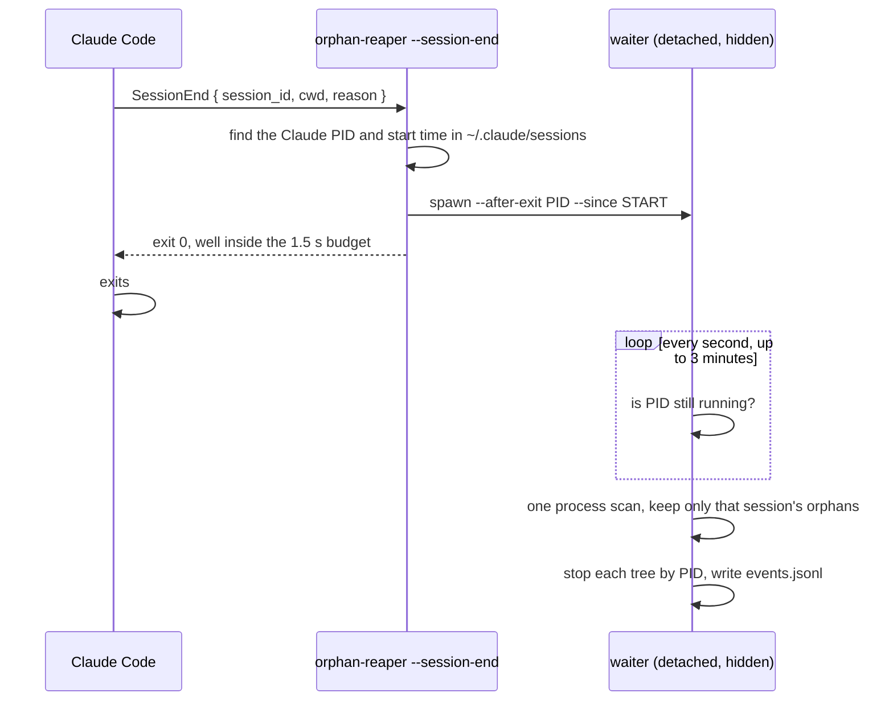
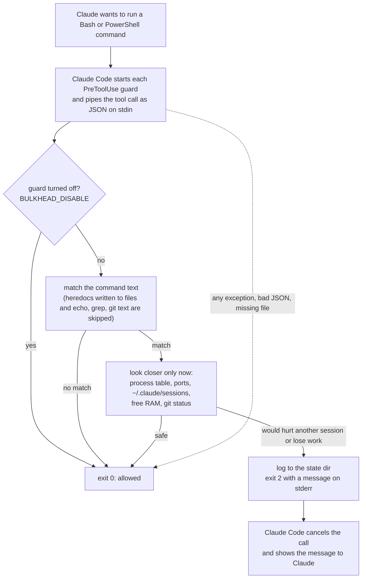
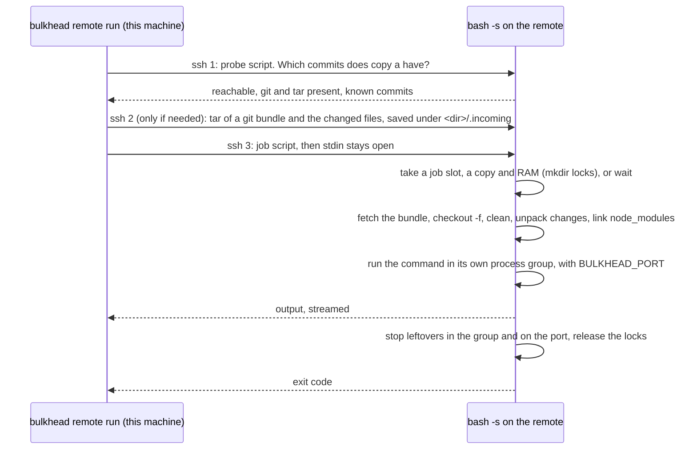

# Architecture

[Back to README](../README.md)

claude-bulkhead is a Claude Code plugin made of small Node scripts. There is no daemon and no server. Each hook runs when Claude Code calls it, reads what it needs, and exits.

## Hook events

| Event | Matcher | Scripts | Timeout |
|---|---|---|---|
| `SessionStart` | `startup\|resume` | orphan-reaper, run with `async: true` so the session does not wait | |
| | `startup` | config-check: one notice when a config file is broken | 10 s |
| `SessionEnd` | all reasons | orphan-reaper `--session-end`: starts a detached waiter and returns at once (it does nothing for `clear` and `resume`) | Claude Code's 1.5 s budget |
| `PreToolUse` | `Bash\|PowerShell` | kill-guard, wait-guard, basics | 10 s |
| | | memory-guard, checkout-guard | 15 s |
| | | port-guard | 20 s |

The registration lives in [hooks/hooks.json](../hooks/hooks.json). The timeouts are upper bounds that Claude Code enforces; a normal run takes about 50 ms.

## After a session ends



The waiter is the only bulkhead process that outlives a hook. It needs no state of its own: everything it knows comes from its arguments, and it exits after one pass. The rules, the keep list and the ownership proof are in [guards/orphan-reaper.md](guards/orphan-reaper.md).

## A PreToolUse decision



Every guard goes through one helper, `runHook` in [src/hook.js](../src/hook.js). It reads stdin, calls the guard, and maps the result to an exit code:

- nothing returned: exit 0, the call goes ahead;
- `{ block: message }`: the message goes to stderr and the process exits 2, which Claude Code treats as a block and shows to Claude;
- `{ output: object }`: printed as JSON on stdout, for hooks that add context instead of blocking.

## Fail-open

If a guard throws, gets input it cannot parse, or cannot read the process table, it exits 0 and the call goes ahead. A bug in a guard should cost you protection, not your work. The one case that looks different is a missing Node: then Claude Code cannot start the hooks at all and shows a `hook error` notice on every tool call, but nothing is blocked.

## Shared state directory

Every session on the machine uses the same directory, `~/.claude/bulkhead` by default (`BULKHEAD_STATE_DIR` to move it). It is fixed rather than per plugin install because `bulkhead-slot` runs from the Bash tool, which does not get the plugin's data directory, and both sides must see the same slot files.

```
~/.claude/bulkhead/
  config.json       global config file (optional)
  slots/            one JSON file per running heavy job (owner PID, GB, start time, label)
  queue/            one JSON file per bulkhead-slot job that is waiting
  guards.log        one plain text line per block, with the rule name
  events.jsonl      one JSON line per block, read by bulkhead log and bulkhead top
  events.jsonl.1    the previous log, after rotation at 1 MB
  statusline.json   the cached status line, 5 seconds
  remote-logs/      full output of bulkhead remote run --tail, the newest 50
  remote-last.json  the copy each project's last remote run used, for bulkhead remote fetch
```

`events.jsonl` can be turned off with `BULKHEAD_NO_LOG=1` or `"log": { "enabled": false }`. A project can add `<repo>/.claude/bulkhead.json`; project settings win over the global file, and environment variables win over both. memory-guard blocks commands that write or delete slot files by hand.

## Finding sessions and processes

A session is a running `claude` CLI process. Its ID and project directory come from the session file Claude Code writes in `~/.claude/sessions`.

| | Process table | Listening ports | Project directory |
|---|---|---|---|
| Windows | `Get-CimInstance Win32_Process` through PowerShell | `Get-NetTCPConnection -State Listen` | session file |
| Linux | `/proc/<pid>/stat`, `cmdline`, `environ` | `/proc/net/tcp` and `tcp6`, matched to socket inodes in `/proc/<pid>/fd` | session file, or `/proc/<pid>/cwd` |
| macOS | `ps -axww -o pid,ppid,rss,lstart,args`, and `ps -axwwE` for `CLAUDE_PID` | `lsof -nP -iTCP -sTCP:LISTEN` | session file |

A process belongs to the session whose `claude` process is its ancestor. On Linux, a server that was reparented to init still counts for its session through the `CLAUDE_PID` variable it inherited. On Windows, a server whose tool shell has exited is matched through the shell snapshot name, but only when exactly one session started at that time.

## Free RAM

- Linux: `MemAvailable` from `/proc/meminfo`.
- Windows: available physical memory and commit charge from `Win32_OperatingSystem`.
- macOS: estimated from `vm_stat` as total minus app memory (anonymous minus purgeable pages), wired and compressed pages, because `os.freemem()` is close to zero on a healthy machine.

## Performance

On a Windows 11 desktop with Node 24, `node scripts/bench-hooks.js 15` measured 40 to 49 ms per guard on an allowed command (median of 15 runs), and 33 ms for starting Node alone. Writing a block to the event log adds no measurable time. So almost all of the cost is starting Node. The expensive reads only happen after a text match:

- port-guard first tries a TCP connection to the port on `localhost`, which takes a few milliseconds. It reads the process list, which takes a second or two on Windows, only when something answers.
- checkout-guard runs git only when the command matches and another session is alive.
- basics runs `git status --porcelain` only for `git reset --hard` and `git clean`.
- `bulkhead-statusline` does not scan processes, takes under 100 ms and caches its line for 5 seconds.

## bulkhead remote

The optional `bulkhead remote` command is the only part that connects to another machine, and only when you run it with a remote you configured. The guards never do.



- Every remote script is a bash script built in memory and sent on ssh's stdin to `<shell> -s`, so the remote needs no install and the login shell can be bash, zsh or Windows cmd. Each script is a single `{ }` group: bash reads a script from a pipe as it goes, and without the group the disconnect watcher's `read` would consume the rest of the script.
- Lines meant for bulkhead go out as `@@bulkhead-<random token> key value`, so nothing a job or a login script prints can be mistaken for them. The local side turns them into the `[bulkhead remote]` lines.
- Copies, locks, the port registry and stale-lock rules are described in [remote.md](remote.md#how-it-works). The code is in [src/remote.js](../src/remote.js) (this side) and [src/remote-sh.js](../src/remote-sh.js) (the scripts).
- Tests run the remote side on the test machine through `test/fake-ssh.js`, set as `BULKHEAD_SSH`. A CI job on Linux runs `scripts/remote-e2e.sh` against a real sshd on localhost.

## No network

The guards send nothing anywhere. Their only socket is port-guard's connection attempt to `localhost`. `bulkhead remote`, when you configure and run it, connects to your remote with your `ssh`.
